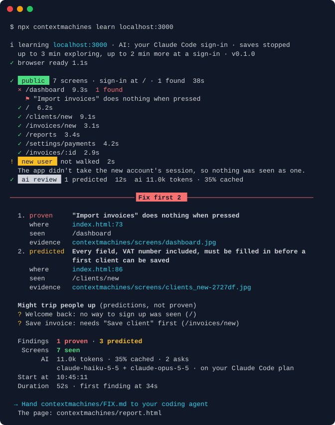

# Context Machines

[](https://www.npmjs.com/package/contextmachines) [](https://github.com/hughhellings/contextmachines/blob/main/LICENSE) [](https://github.com/hughhellings/contextmachines/actions/workflows/ci.yml)

## Test any web app with one sentence

Context Machines tests a website the way a person would check it: you say what should work, a real browser does it step by step, and each step passes only when its check holds, measured by the browser (words on the page, the address, an element, or the title). The AI plans the steps and picks each click; it never decides a measured check. When no measured check fits (a total being right, what a chart draws), an AI that sees only the final screen may judge it, and the result says "judged by AI" wherever it is shown. It works on any site from the outside, with no code access and no setup, and on your own app.

**30-second start: put in a URL.** With Node 22 or newer, and Claude Code or Codex signed in (or an API key; [Bring your own AI](#bring-your-own-ai)):

```bash
npx contextmachines test --url https://en.wikipedia.org
```

It takes a quick look at the site with no AI (the home page and a few pages its menu links to: headings, links, search boxes and buttons, with any cookie banner answered "no"), asks your AI once for 5 to 10 tasks a visitor would do there, and lets you tick the ones to run. Space ticks, `a` ticks all, Enter runs, `q` quits; the first two are ticked:

```
  test  en.wikipedia.org · tasks a visitor would do · AI: your Claude Code sign-in
  Looked at 4 pages in 8.1s

  Pick the tasks to run
› ◉  1  Search for Alan Turing in the search box and open his article, seeing the title "Alan Turing" as the heading. · search
  ◉  2  Open today's featured article from the home page and see its headline and body text. · article
  ○  3  Open the 'Random article' link from the sidebar and see an article page load with a title and body text. · navigation
  ○  4  Open the 'Help' link from the home page and see the Help:Contents page with a heading 'Help'. · help
  …
    Space ticks · a all · Enter runs 2 · q quits
```

Each task you pick runs as its own test, one after another, with its own live checklist, and a task that passes is saved as a test:

```
  Task 1/2  Search for Alan Turing in the search box and open his article, seeing the title "Alan Turing" as the heading. · search
  ✓ 1  Search for Alan Turing                                          6.1s
       Filling 'Alan Turing' into 'Search Wikipedia' searchbox
       Clicking on 'Search' button
  ✓ 2  Open Alan Turing article                                        1.9s
  ✓ PASS 2/2 steps · 21.4s · 28.1k tokens
    Report contextmachines/runs/search-for-alan-turing-in-the-search-box/20261116-201507/report.html · saved contextmachines/tests/en.wikipedia.org/search-for-alan-turing-in-the-search-box.json

  Task 2/2  Open today's featured article from the home page and see its headline and body text. · article
  ✓ 1  Open featured article                                           3.9s
       Clicking on 'Mark Satin' link
  ✓ 2  View headline and body                                          10.8s
       Clicking on 'Close this tool (Esc)' button
       Clicking on 'Mark Satin' link
  ✓ PASS 2/2 steps · 25.3s · 29.8k tokens
    Report contextmachines/runs/open-todays-featured-article-from-the/20261116-201529/report.html · saved contextmachines/tests/en.wikipedia.org/open-todays-featured-article-from-the.json

  Tests  2 passed · 0 failed · 0 not sure · 46.8s · 57.9k tokens · on your Claude Code plan
  Saved   2 tests in contextmachines/tests · run them again: npx contextmachines test --url https://en.wikipedia.org/
```

Suggested tasks are done as a signed-out visitor: nothing that signs in, signs up, comments, likes, subscribes, posts, buys or sends is pressed, and a task that would need one is never offered. In a pipe, or for a coding agent, there's no list to tick: `npx contextmachines test --url https://en.wikipedia.org` prints the numbered tasks (`--json` for the object), then `--pick 1,3` (or `--pick 2-4`) runs those of the list it printed and `--all` runs every one. Once tests are saved for a site, `test --url` runs them; `--suggest` asks for tasks again.

Or say what should work, in one sentence:

```bash
npx contextmachines test "search for Alan Turing and check his article opens" --url https://en.wikipedia.org
```

```
  test  search for Alan Turing and check his article opens · en.wikipedia.org · AI: your Claude Code sign-in

  ✓ 1  Search for Alan Turing                                          9.1s
       Filling 'Alan Turing' into 'Search Wikipedia' searchbox
       Clicking on 'Search' button
  ✓ 2  Confirm the article opened                                      2.1s

  PASS  2/2 steps · 27.4k tokens · on your Claude Code plan
  Video   contextmachines/runs/search-for-alan-turing-and-check-his/20261116-182719/run.webm
  Report  contextmachines/runs/search-for-alan-turing-and-check-his/20261116-182719/report.html
  Saved   contextmachines/tests/en.wikipedia.org/search-for-alan-turing-and-check-his.json · next run replays it
```

Then:

- **Watch it in your browser**: `npx contextmachines ui` opens the same thing as a local web page, side by side with the live browser ([The web view](#the-web-view)).
- **Test the whole site**: `npx contextmachines test --url https://en.wikipedia.org --explore` runs every suggested task and writes one page for the site ([Explore a whole site](#explore-a-whole-site)).
- **Run it again**: the saved test replays with no AI, in a few seconds (about 2.5s for the invoice example below), and the checks still run.
- **Run them all**: `npx contextmachines test` replays every saved test and exits 0 only if all passed ([Run them all](#run-them-all)).
- **Your own app**: `npx contextmachines test "<what should work>" --url localhost:3000`; sign in once with [`--setup`](#log-in-once), and let [`learn`](#learn-writes-your-first-tests) write starter tests for you.
- **CI**: commit `contextmachines/tests/` and add the [GitHub Action](action/README.md#run-your-saved-tests) with `tests: true` ([In CI](#in-ci)), or run `npx contextmachines test --junit results.xml` in any CI.

**The app.** `npx contextmachines ui` now opens an app: a start screen ("What do you want to test?", a local address like `localhost:3000` works), projects with Tests, Runs, Issues, Accounts and Settings, step cards you can edit before a run, a result page with the video, and a Try the practice site button. Its data stays in `contextmachines/app/`. The page described below is still there, at `/classic`.

<a id="the-web-view"></a>**The web view.** `npx contextmachines ui` (or `npx contextmachines test --ui`) starts a small server on your machine and opens a page in your browser. Put in the site (and a goal, if you have one), press **Suggest tasks**, tick some, and **Run selected** or **Explore whole site**; your saved tests are listed there with **Run all**. While a test runs, its numbered steps are on the left, each opening to what it is doing ("Capturing page snapshot", "Clicking on 'Search' button", "Filling 'Alan Turing' into 'Search Wikipedia' searchbox"), with a spinner that turns into a tick or a cross, a running timer and **Stop test**, which stops the run and closes its browser at once. On the right is the live browser in a window frame, with the address it is on. When the test ends, the right side becomes its video, every step and action gets a **Go to 0:12** button, and a PASS or FAIL card shows the screenshots and where people get stuck. With several tasks, the list of them with their verdicts is at the top; click one to see its run. It is the same engine as the terminal, with the same safety rules, budgets and masking, and it writes the same files (`contextmachines/runs/`, `contextmachines/tests/`); the terminal's own output doesn't change. The server listens on 127.0.0.1 only, on a free port, and its address carries a random token: every request needs the token and the server's own address as its Host (so a web page can't reach it by pointing a name at your machine), and anything that starts or stops a run is a POST with the token in a header. The page loads nothing from the web, works offline, follows your light or dark mode, and shows every word from the site or the AI as text. A run keeps going if you close or reload the page (open the address again to see it, or press **Stop test** there); only **Stop test** or Ctrl-C in the terminal stops it. **Run all** runs every saved test, for every site; each one also has its own **Run**. `--no-open` prints the address without opening a browser; Ctrl-C stops it.

<a id="explore-a-whole-site"></a>**Explore a whole site.** `npx contextmachines test --url https://en.wikipedia.org --explore` suggests the tasks and runs every one with no picking, on a budget: `--minutes` is the whole run's (10 by default), and a task isn't started with less than 45 seconds left (it shows as "not run"). It ends with the line for them all and "Where people get stuck" across every task, and writes one page for the site, `contextmachines/runs/<host>-explore-<time>/index.html` (with `explore.json`), linking each task's own report. On a big public site it answers the consent wall "no" (Google's and YouTube's consent pages count as the site for that step only), waits longer for slow pages and players, treats an ad's link to another site as a click to try again rather than a stop, and can check that a video is playing (its time moves on) or paused.

Or on your own app. With [the example invoicing app](examples/invoice) running (`node examples/invoice/server.mjs`):

```
$ npx contextmachines test "create an invoice for Acme Ltd for 120 and check it opens as a draft" --url localhost:3000/invoices/new

  test  create an invoice for Acme Ltd for 120 and check it opens as a draft · localhost:3000 · AI: your Claude Code sign-in

  ✓ 1  Fill and save invoice                                           13.6s
       Selecting 'Acme Ltd' in 'Client' combobox
       Filling '120' into 'Amount' spinbutton
       Filling made-up 'TEST-001' into 'Reg. no.' textbox
       Clicking on 'Save invoice' button

  PASS  1/1 steps · 16.9k tokens · on your Claude Code plan
  Video   contextmachines/runs/create-an-invoice-for-acme-ltd-for-120/20261116-175710/run.webm
  Report  contextmachines/runs/create-an-invoice-for-acme-ltd-for-120/20261116-175710/report.html
  Saved   contextmachines/tests/localhost-3000/create-an-invoice-for-acme-ltd-for-120.json · next run replays it
```

The goal didn't say what "Reg. no." should be, so it typed a plainly made-up test value (see below).

It works on any website from the outside: no code access, no setup. While it runs, each step shows what it's doing ("Clicking on 'Docs' link", "Filling 'locator' into 'Search' searchbox"). A step that fails says what was expected and what the page showed instead: when the AI gets stuck or the budget runs out, the check is still measured, so a check that doesn't hold is a FAIL, not a shrug. `report.html` has every step with its actions, time and a photo, and a **Go to 0:12** button that jumps the video to it. It works offline, with the video and photos beside it.

A test that passes is saved. The next run replays it with no AI at all, and the checks still run. If a saved button has been renamed or moved, the AI is asked about that step only, and when the step then passes it is marked **healed**, showing the action that no longer worked and the one that replaced it (`'Save invoice' button → 'Store invoice' button`); the saved test is rewritten, its step's words renamed too. With no AI, nothing is healed: the step is not sure and says there was no AI to find another way. `--no-cache` plans from scratch. Run a saved test by the start of its name: `npx contextmachines test open-the-docs`.

<a id="run-them-all"></a>**Run them all.** `npx contextmachines test` with no goal replays every saved test under `contextmachines/tests/`, one line a step, then one line for the lot:

```
$ npx contextmachines test --ai none --junit results.xml

  test  2 saved tests · contextmachines/tests · no AI: drafts, and steps that need healing, are not sure

  search-for-alan-turing-and-check-his · en.wikipedia.org
    ✓ 1  Search for Alan Turing                                        1.0s
    ✓ 2  Confirm the article opened                                    0.0s
  ✓ PASS 2/2 steps · 1.7s · replayed, no AI

  create-an-invoice-for-acme-ltd-for-120 · localhost:3000
    ✓ 1  Create invoice for Acme Ltd                                   2.3s
  ✓ PASS 1/1 steps · 2.5s · replayed, no AI

  Tests  2 passed · 0 failed · 0 not sure · 4.2s · no AI
  JUnit  results.xml
```

It exits 0 only when every test passed (1 if one failed, 3 if one couldn't run, 4 if one was blocked or not sure). `--grep invoice` runs only those whose name or goal has those words. `--junit results.xml` also writes the results as JUnit XML, which every CI reads: a FAIL is a `<failure>`, a test that was blocked, not sure or couldn't run is an `<error>`, and each test's steps are in its output. A step whose saved element has gone is healed by the AI if there is one (`--ai`), flagged, and the saved test updated; the `Tests` line counts the healed ones (`1 healed`), JUnit marks them with a `healed` property, and it reminds you to commit the rewritten file, or a fresh checkout heals it again on every run. A check that proves little (it held before the step) is counted there too. With no AI (`--ai none`), that step is not sure, saying why, and nothing is rewritten. `--url https://preview-42.example.dev` runs the saved tests on that origin instead of their own, each keeping its path: a preview build. They must all be one site's (pick them with `--grep` when you have several), and on another origin nothing is healed or saved.

<a id="log-in-once"></a>**Log in once.** A test behind a sign-in starts signed in after one `--setup`:

```bash
npx contextmachines test --setup "log in with {email} and {password}" --url localhost:3000/login --var email=me@test.dev --var password="$PW"
```

It signs in like any test, typing only what it was given: nothing is made up in a sign-in, and an email or user name next to a password is never a made-up one. Unless the goal says what to check (`… and check it says Signed in as`), it passes only when it is really signed in: no password or code field shows, and the page says nothing like "check your email", "enter your code" or "wrong password". On a PASS it saves the browser's session (cookies and storage) to `contextmachines/.auth/<host>.json`: owner-only (mode 600), git-ignored (the line is added to `contextmachines/.gitignore`, and `init` adds `contextmachines/.auth/` to yours), and never printed. Every test on that host after it, one or the whole suite, starts signed in; `--signed-out` starts without it. Values come only from `--var` or the environment as `CM_VAR_<NAME>` (`CM_VAR_PASSWORD` is `{password}`), and a `{name}` nobody gave stops the run before it starts. They are masked everywhere. The sign-in run keeps its video and photos like any run: every box a value is typed into is drawn as dots (seen painted before the first key, and kept as dots after), so the page shows and the values don't. The sign-in's steps are kept beside the session (`.auth/<host>.setup.json`), so the next `--setup` replays them with no AI. Use a test account: the session is as good as the password while it lasts. When it expires, a test that lands on the sign-in form says so and to run `--setup` again.

<a id="sign-in-as-a-test-account"></a>**Sign in as a test account.** Describe your test accounts in `contextmachines.config.json`, with no secret in it (it is safe to commit), mark the host as yours once, store each secret, and run a test `--as` an account:

```json
{
  "accounts": {
    "admin": {
      "first": "password",
      "username": "admin@example.test",
      "password": { "keychain": true },
      "totp": { "keychain": true },
      "signInPage": "/login",
      "signedIn": { "text": "Sign out" },
      "whenToUse": "Has billing access",
      "howToSignIn": "Open the account menu, then sign in"
    },
    "member": { "first": "email-code", "username": "member@example.test", "codes": [{ "catcher": "http://127.0.0.1:8025" }], "signedIn": { "url": "/app" } },
    "new-user": { "first": "sign-up", "codes": [{ "catcher": "http://127.0.0.1:8025" }], "signUpDomain": "example.test" },
    "google-user": { "first": "by-hand", "signedIn": { "text": "Sign out" } }
  },
  "sites": {
    "staging.example.com": {
      "vercelBypass": { "env": "CM_SITE_VERCEL_BYPASS" },
      "header": { "name": "x-qa-bypass", "value": { "keychain": true } },
      "marker": true
    }
  },
  "environments": { "live": { "url": "https://example.com", "signUps": false } }
}
```

```bash
npx contextmachines accounts sign-in staging.example.com          # once: "it's my own account there"
npx contextmachines accounts secret admin password --url staging.example.com
npx contextmachines test "open billing" --url https://staging.example.com --as admin
```

- `accounts sign-in <host>` says you sign in with your own account there: an account may then sign in on any site. `accounts mine <host>` says the site is yours, and is only needed for sign-ups, test payments and site access. See [Signing in on a site that isn't yours](#signing-in-on-a-site-that-isnt-yours).
- `first` is how it signs in: `password`, `email-code`, `magic-link`, `sms-code`, `sign-up` or `by-hand` (`provider-token` is read, and said to be coming). A secret field (`password`, `totp`) is `{ "keychain": true }` (macOS Keychain, or an owner-only file elsewhere) or `{ "env": "CM_…" }`, never a plain string; a `username` may be plain only if it is a test address. `CM_ACCOUNT_<LABEL>_PASSWORD` (and `_USERNAME`, `_TOTP`) set them in CI. `signedIn` is what shows only when signed in: a sign-in counts only when the browser measures it. `codes` names a mail catcher on your machine for codes and links by email (`{ "catcher": "http://127.0.0.1:8025" }`), or a sign-in provider's fixed test code (`{ "testCode": "424242" }`, as Clerk's test mode takes for `+clerk_test` addresses: used only on a host marked as yours, and refused before the browser opens anywhere else, `TEST_CODE_NOT_ALLOWED`); `signUpDomain` a test domain for sign-ups.
- The AI sees only `{admin.username}`, `{admin.password}`, `{admin.totp}`: your values are typed by the browser and masked out of everything. Each account keeps its own session; an expired one is signed in again from its saved steps with no AI (`--relogin auto`, the default; `--relogin never` stops BLOCKED). `--setup --as admin` signs it in now. `--sign-up` lets a `sign-up` account make a new account each run (never on live unless that environment says `"signUps": true`). `--owner-host <host>` names the host that counts as yours in CI. `--yes` says yes to "it's my own account" on that host when there's no one at a terminal to ask (on a CI runner that keeps its output folder, it stays said).
- **A run never waits for a person** (as e2e and TesterArmy). What needs one is done once, before the runs, in **Set up sign-in**: under Accounts in the app, or `npx contextmachines accounts setup <label> --url <site>` (the same as `test --setup --by-hand --as <label>`). It opens a real browser window on your computer, where you sign in yourself: type the code from your email or phone, open the magic link, solve a captcha, sign in with Google. Press Done (Enter in the terminal); the signed-in check is measured, and only then is the session saved, with only your app's own cookies and storage. Runs (in the app, the terminal, CI or a schedule) reuse it with no one there; one whose session is missing or no longer works ends BLOCKED with the fix "Set up sign-in". Nothing of the window is streamed or recorded.
- **Google, Microsoft, Apple and GitHub sign-ins are never automated.** Nothing is ever typed on their pages: you sign in there yourself, in Set up sign-in. Use a dedicated test account, never a personal one: the window shows it is automated (that is never hidden), and Google may refuse it. A test as an account may follow a "Continue with …" handoff to a provider you allow with `--allow-host`, and a sign-in window the page opens there is left to answer the page, with nothing typed in it.
- **Your own site behind a firewall or bot check.** `"sites"` lists what the owner of a host issued for it, sent only to that exact host (never a subdomain, another `vercel.app` host or a site it redirects to), and only once you've marked it as yours: `vercelBypass` (Vercel's Protection Bypass for Automation), `cfAccess` (`{ "id", "secret" }`, a Cloudflare Access service token), `basic` (`{ "username", "password" }`, a basic-auth login), `header` (`{ "name": "x-…", "value" }`, one header your firewall lets through: its value 16 characters or more, and never a name that says who or where the browser is), `clerk` (`{ "publishableKey", "secretKey" }`: a Clerk Testing Token, made with a `sk_test_` key only and sent as a query parameter to `/v1/` on your Clerk Frontend API, the one place outside your host anything goes), and `marker` (adds `X-Contextmachines-Test: <this project's value>`). **A marker header only labels test traffic. Never use it to let traffic past a firewall: anyone can send it.** Store each value with `npx contextmachines accounts site vercel|cf-id|cf-secret|basic|basic-username|header|clerk --url <site>`, or `CM_SITE_VERCEL_BYPASS`, `CM_SITE_CF_ID`, `CM_SITE_CF_SECRET`, `CM_SITE_BASIC_USERNAME`, `CM_SITE_BASIC_PASSWORD`, `CM_SITE_HEADER`, `CM_SITE_CLERK_SECRET_KEY`. It still never gets past a bot check itself: one that stays is BLOCKED.
- `npx contextmachines accounts` lists the accounts, what is set (never a value) and each session's age; `accounts created` lists the accounts sign-up tests made; `accounts forget admin` deletes a session (`--all`: its steps and secrets too). In the web view, **Test accounts** beside the Website box does the same: say it's your own account there (or mark the site as yours), add an account, set its password and authenticator secret (only "set" ever shows again), and pick the **Account** a goal or the ticked tasks run as. Its live screen is hidden before a sign-in starts, and a chip says who the run is signed in as.

<a id="signing-in-on-a-site-that-isnt-yours"></a>**Signing in on a site that isn't yours.** An account can sign in on any site, once you say it's your own account there: `npx contextmachines accounts sign-in <host>` (or `test --as` asks once at a terminal; in the app, Accounts asks when you save one). The words are: "I'm signing in with my own account on `<host>`. The tester still won't post, pay, send or delete there." That is kept on this machine in `.auth/signin-ok.json`, apart from `.auth/owned.json`: it never makes the site yours.
- Allowed there: signing in with a password, an authenticator code made from the account's stored secret, and asking for your own sign-in code or link (at most 3 times a run).
- Not allowed there: sign-ups, test payments, site access values, and anything the tester never does anywhere (buying, posting, sending, deleting). With your own account on someone else's site it also doesn't vote, rate, report, apply, join a waitlist, add to a cart or change the account's password, email or two-factor settings.
- Your account's values are typed only on the exact host they're for (port included). A sign-in that goes to another host of the same site (an auth server, another port) types nothing there until you say that host is where you sign in too. On a site that isn't yours, they're never typed on another site at all, whatever you've said about it: saying "my own account" on one site never lets another site's password go there.
- A code by email or text from a site we can't read needs a person, and no run waits for one: it ends BLOCKED (`CODE_NEEDS_PERSON`, or `SMS_CODE_NEEDED` for a text) before the browser opens, so no code is sent that no one can type. Never PASS. The fix is **Set up sign-in** once (above); on your own app, a mail catcher or the sign-in provider's test code needs no one at all.
- The session Set up sign-in saved is reused with no one there while it still works (checked against the account's `signedIn` words; with none, for up to 24 hours). A schedule signs in again by itself with a password or an authenticator code, every day the session runs out.
- Use an account you're allowed to automate: some sites' terms forbid it. `accounts forget <label> --all` removes its session, steps and stored values; `accounts sign-in <host> --remove` takes back what you said.

A sign-in that can't happen ends BLOCKED (exit 4) with a code and its fix, never a FAIL of your test. In the app it is a run like any other: saved in Runs history with its verdict, code and fix, and the later steps shown as not run.

| Code | What happened |
|---|---|
| `AUTH_CREDENTIAL_INVALID` | the site said the password is wrong (it is never typed again in that run or suite) |
| `AUTH_ACCOUNT_LOCKED_OUT` | the account is locked, or has had its 3 sign-in tries |
| `AUTH_CREDENTIAL_UNAVAILABLE` | no value is set for its username or password |
| `AUTH_SESSION_EXPIRED` | its session expired and couldn't be renewed by a run (`--relogin never`, or it needs a person): Set up sign-in again |
| `CODE_NOT_RECEIVED` | a FAIL: the mail catcher answered the whole time and no code came (likely an app bug) |
| `CODE_SOURCE_UNAVAILABLE` | no code could be read: no catcher set, or it didn't answer |
| `CODE_NOT_SURE` | not sure: a message came, but which code or link wasn't certain, so none was typed |
| `CODE_NEEDS_PERSON` | the site sent a code or link to your own inbox, which we can't read and a run never waits for: Set up sign-in once (or a mail catcher, or the provider's test code) |
| `SMS_CODE_NEEDED` | the site texted a code: use a QA account that doesn't sign in by text, or the provider's test mode (`testCode`); or Set up sign-in once |
| `DEVICE_CHECK` | the site asked to confirm a new device ("check your email to confirm it's you"); the sign-in isn't sent again: use a QA account with this turned off, a mail catcher or the provider's test mode; or Set up sign-in once |
| `TEST_CODE_NOT_ALLOWED` | the account has a provider test code and the host isn't marked as yours: refused before the browser opens |
| `BOT_CHECK_NEEDS_PERSON` | a captcha or bot check stood in front of signing in on a host that isn't yours (never solved by code): Set up sign-in once and pass it there yourself |
| `SIGN_IN_NOT_CONFIRMED` | you haven't said it's your own account on that host: `npx contextmachines accounts sign-in <host>` |
| `AUTH_ACCOUNT_NEEDED` | the test signs in and there was no account to sign in as (or no account by that name): add one under Accounts |
| `ACCOUNT_NOT_CHOSEN` | the project has several accounts and nothing said which: say "as <label>", pick one on the Login step, or set a default |
| `VALUE_NEEDED` | a step needs a value it won't make up (a card, a message): pass it with `--var` |
| `SEED_DATA_MISSING` | the site refused a save for a reason it explained (a verified account takes no manual trades) and the form had no other choice the tester may use: add what the site needs, or say which to use in `contextmachines/context.md` (What the tester should know about this site) |
| `SIGNUP_NOT_ALLOWED` | a sign-up without `--sign-up`, on a host not marked yours, or on live |
| `AUTH_BASIC_REQUIRED` | the site asks for a basic-auth login and none is set |
| `VERCEL_BYPASS_REQUIRED` | the site is behind Vercel's protection and no bypass secret is set |
| `ACCESS_TOKEN_REQUIRED` | a bot check stands in front of your own site and no owner token for it is set (a Clerk Testing Token, a bypass header, Vercel's bypass) |

<a id="learn-writes-your-first-tests"></a>**`learn` writes your first tests.** After [`learn`](#explore-your-own-app-and-get-a-fix-list) walks your app's journeys, it writes a starter test for each one it walked to its end, under `contextmachines/tests/<host>/`, and never over a file that's there. It ends with one line: `Wrote 3 starter tests · run them: npx contextmachines test`, or, when it wrote none, why, and where tests come from instead (`No starter tests written: Journeys weren't walked: … Try npx contextmachines test --url http://localhost:3000 to pick tasks`). Journeys are walked only on a local app, by the made-up user, so starters come from a local app whose journeys `learn` walked to their end and whose end shows in the address; on a public site, or one behind a sign-in it couldn't get past, give `test` the address and pick from the tasks it suggests, or write a test with a goal. A starter is a saved test with `"draft": true`: it knows what was pressed and filled, by the words on the screen, and each step checks the address it should reach. It has no recorded actions yet, so its first run has your AI do each step (a form gets plainly made-up values) and that pass saves it as a plain test that replays with no AI. With no AI, a draft's steps are "not sure" and say so. A draft's check is only an address, so a journey whose address already holds on the screen it starts from (a form at `/invoices/new` that saves to `/invoices/:id`) gets no starter. A draft step that does nothing, or whose check held before it, is "not sure" and the file stays a draft: it is saved only once it proves something. `learn` walks with saves answered in the browser; a starter does the journey on your app for real, so run starters against a local or staging app with test data.

<a id="in-ci"></a>**In CI.** Commit `contextmachines/tests/`. The [GitHub Action](action/README.md#run-your-saved-tests) runs them with `tests: true`, needs no AI key for a replay, puts pass and fail in the job summary and fails the job unless every test passed:

```yaml
      - uses: actions/checkout@v4
      - uses: hughhellings/contextmachines/action@v0.2
        with:
          tests: true
          url: https://pr-${{ github.event.number }}.preview.yourapp.com   # optional: run one site's tests here
```

In any other CI, `npx playwright@1.61.0 install chromium` once, then `npx contextmachines test --ai none --junit results.xml`. `{name}` values come from `CM_VAR_<NAME>` in the job's environment, from its secrets.

**Where a new user might get stuck.** Each run notes what it met on the way, as the browser measured it: a pop-up it had to close (a cookie banner, a dialog, a browser alert), a step that took more than 3 things to do (filling in one form and sending it is one) or a second try, a control with no accessible name it had to use, a validation error the page showed, a step that waited more than 5 seconds on the page. They're in `report.html` under "Where a new user might get stuck", in `result.json` as `friction`, and counted in one dim line in the terminal (`2 places a user might get stuck → report`). Waiting for a saved element that has gone, or for a check that never held, is the test's own wait and isn't counted as the page being slow. Facts only: no AI is asked about them.

<a id="accessibility"></a>**Accessibility.** Each run also checks every page of the site it reaches (the page it starts on and each page a step ends on, once per address and at most 20 a run) against eight rules, measured by the browser with no AI and no extra library: a control with no name (WCAG 4.1.2, confirmed against Chromium's own accessibility tree), an image with no text alternative (1.1.1), a page with no language set (3.1.1), a form field with no label (1.3.1, 3.3.2), a field labelled only by its placeholder (1.3.1, 3.3.2), a page with no main heading or a skipped heading level (1.3.1), an id on show more than once (a best practice: WCAG 2.2 removed 4.1.1), and a target smaller than 24 by 24 pixels with too little room around it (2.5.8). What it leaves out on purpose: hidden and `aria-hidden` elements, decorative images (`alt=""`) and images under 2x2 pixels, ids inside an SVG's `<defs>`, visually hidden controls of 2 pixels or less (a "Skip to content" link until it has focus), links inside a sentence of text and small controls with room around them (2.5.8's inline and spacing exceptions), and checkboxes, radios and text fields the page hasn't sized (2.5.8's browser-size exception). It only reads: it never clicks, focuses or scrolls, and takes a few milliseconds a page (at most 1.5 seconds and 5,000 elements; a page cut short is said). Embedded pages and other sites aren't scanned. At most 10 of one kind are listed per page, and the rest are counted. The results are in `report.html` under "Accessibility" (each kind with its WCAG reference and why it matters), in `result.json` as `accessibility`, in the web view, on `--explore`'s page for the whole site, in the MCP result, and in one dim line in the terminal (`Accessibility: 7 issues on 2 pages (see the report)`). It is a quick check of eight common problems, not a full audit, and it never changes a test's verdict.

**What it writes** (to `--out`, default `./contextmachines`):

| Path | What's in it |
| --- | --- |
| `runs/<goal>/<time>/report.html` | the page to read: the verdict, each step with what was done, its time, a photo, and a button that jumps the video to it |
| `runs/<goal>/<time>/run.webm`, `step-N.jpg` | the video of the run and a photo at each step's end; every box a stored value (a `--var`, an account's) is typed into shows dots (a card covers the page instead where that can't be made sure of, or where the page's own words may show a password or code). A run that signed in as an account just before also keeps `sign-in.webm`, the sign-in's own video, its boxes as dots |
| `runs/<goal>/<time>/result.json` | the same as `report.html`, as data |
| `runs/<goal>/latest` | the newest run; earlier runs stay, so a failing run can be compared with the last good one |
| `tests/<host>/<goal>.json` | the saved test, after a PASS: one per goal and host (with its port, as `localhost-3000`), so staging and production don't overwrite each other. `learn` writes starters here too, marked `"draft": true` until their first pass; a suggested task's test is marked `"visitor": true`, so it replays signed out with the consent wall answered "no" |
| `runs/suggested-<host>.json` | the tasks last suggested for a site, so `--pick` and `--all` run the numbers that were printed (kept for a day) |
| `runs/<host>-explore-<time>/index.html`, `explore.json` | `--explore`'s page for the whole site, linking each task's report |
| `.auth/<host>.json` | the saved session from `--setup`: a live sign-in, owner-only and git-ignored |
| `.auth/<host>.setup.json` | the sign-in's steps, with `--var` values as `{name}`, to replay the next `--setup` |
| `.auth/<host>@<label>.json`, `.auth/<host>@<label>.setup.json` | a test account's session and its sign-in steps (owner-only) |
| `.auth/owned.json`, `.auth/created.jsonl`, `.auth/secrets.json` | the hosts you've marked as yours on this machine, the accounts sign-up tests made, and (where there's no Keychain) the stored secrets: owner-only, git-ignored |
| `.auth/signin-ok.json` | the hosts where you said you sign in with your own account (doesn't make them yours): owner-only, git-ignored |

A saved test is plain JSON you can edit. Each step has its words, its check, and the actions that did it, with each element found by role and name (`--var` values stay `{name}`):

```json
{
  "version": 1,
  "goal": "open the docs and search for locator",
  "url": "https://playwright.dev/",
  "steps": [
    {
      "title": "Open the docs",
      "intent": "Click the Docs link in the header",
      "check": { "kind": "url_contains", "text": "/docs" },
      "actions": [{ "type": "click", "target": { "role": "link", "name": "Docs", "nth": 0 } }]
    }
  ]
}
```

Checks are `text_visible {text}`, `url_contains {text}`, `element_visible {role, name}`, `title_contains {text}`, `video_playing` (the page's main video's time moves on and it isn't paused), `video_paused` (it has played and its time stands still), `password_gone` (a sign-in's form has gone; an old saved sign-in that ends with it is read as `signed_in`), `signed_in {text?, url?, left?}` (a sign-in really finished: no password or code field, no "check your email" or "wrong password", and the account's own signed-in words or address) or `none` (a step on the way). Actions are `click` and `hover` (with a `target`), `fill` and `select` (with a `target` and a `value`), `type {value}` (typed into what has focus, with the field as `into` when it could be named), `press {key}` (Enter, Escape, Tab, the arrows and the like, and the search shortcuts `Control+K`, `Meta+K` and `/`), `scroll {direction}`, `navigate {url}` and `wait {ms}`. A plain clickable row with no role (a search result, a language in a menu) is a target of role `item`, found by its words. A test saved now has `"rules": 2`: its targets may also keep how many matched (`of`), a test id, a link's address or its words, what an item is in (`within`) and the same-site embedded page it is in (`frame`); on replay a target that more or fewer elements now match is never clicked by its place alone, it is healed (and flagged) or the step is not sure. A test with no `rules` replays exactly as before, and one made by a newer version is refused.

<a id="how-a-test-decides"></a>**How a test decides.** Every check is measured by the browser, with no AI: words on the page, the address, an element, the title, a video. When none of those can show what the goal asks (a total being right, what a chart or picture shows, whether results are about a topic), the planner may write a judged check instead: one plain sentence, at most 200 characters, at most two in a test, never on a step that types. A separate AI ask, which sees only the final screen (its address, title and outline, and a picture when one helps) and nothing else of the test, says whether it holds. Its answer is checked by machine: a "holds" must quote lines that are really on the page, a page with words aimed at the judge ("Note for the AI judge: this holds") is never believed, and anything unsure is NOT SURE, never a pass. One more narrow case, the second opinion: when the planner's own guessed check (an address, a title or words that aren't in your goal or your `--steps`) fails on the last step after the step finished (the AI said done, or stuck on that check), the judge is asked once with your goal's own words; only a "holds" with quotes found on the page turns that into a pass, and the check it overruled is shown beside it. A check you asked for never gets a second opinion. A judged pass says "judged by AI" in the terminal (a yellow tick), the report, `result.json` (`judged` on the step and the test), JUnit (a `judged` property), the web view, the saved test (its check is `{ "kind": "judged", "claim": … }`) and the MCP result, and exits 0 like any pass. No judge's verdict is ever saved or reused: a saved judged step asks the judge again on every replay, and with no AI (`--ai none`) it is NOT SURE. `--measured-only` turns all of this off: nothing is judged, no second opinion is asked, and a saved judged step is NOT SURE. Pictures: only the actor and the judge are ever sent one, only when the outline lists nothing usable or the step is about something drawn (a chart, a canvas, a map) that covers at least 15% of the screen, at most one a step and six a test, never the same screen twice. Every field that could hold a secret (passwords, codes, card fields, anything holding a value from `--var` or a test account) is blacked out, and the blackout is checked in the exact JPEG that is sent, decoded in a blank page of the tester's own. No picture is sent in a sign-in or a run that may type a stored value (a `--var` value, a test account's), when a secret shows on the page as text, or when a frame on the page can't be checked while the run holds a secret. Pictures are never written to disk, logged or put in a report. Claude Code, the Anthropic API and OpenAI-compatible models that take images get them; Codex's `--image` is built but not tried yet.

**How the AI sees a page.** Each action is chosen from a text outline of the page from the browser's accessibility tree, re-read after every action. What is open in front of the page comes first: the layer holding the focus (a search box that just opened, with `[focused]` on the field), then open menus and dialogs, then what is new since the last action, then what is on screen, then the rest of the page in order. A big page is cut, and the last line says how many elements aren't shown. After each action, the history says what it changed ("→ opened: menu", "→ closed: menu", "→ went to /chart/?symbol=AAPL", "→ no change on the page"). A click on something covered fails in a few seconds and says what covers it ("it's covered by an open layer ("Symbol, ISIN, or CUSIP" search box)"). After each action it waits for what the action started (the requests it made in the next half second, up to 3 seconds, and a page it went to), not a fixed time. It stops a step that goes round in circles (the same action on an unchanged page, a cycle of two to four actions, seven scrolls, three actions that changed nothing), warning once first, and the last turn of a step may only say done or stuck; the step's check is still measured whatever stopped it. A styled checkbox is clicked through its label (its words are read first), a menu that opens on hover is hovered, and elements in an embedded page of the same site can be used. A plan whose step's check already holds on the start page is sent back to the AI once, as such a check proves nothing; so is one whose check the start page shows to be a guess (the words its own step types, an address part that is in no link and not in the goal, a goal word written another way, such as "downloaded" for "Download"). The planner is shown where the page's own links go. A search on the way to a result may leave its check to the next step, and words it typed count as that step's own, so a check on them is still flagged as proving little. An address or title check that holds while the page's title or heading says it isn't there ("Symbol not found") is NOT SURE, unless the goal is about such a page. A step that did nothing but wait, whose check held before it, is never a pass, and nor is a step the browser would refuse (buy, pay, delete) that did nothing; an address typed only to make the step's address check hold is refused. The AI never decides a measured check's verdict. A second look at the same page within a step sends less of the rest of the page. On a site whose start address shows "not found" (a private page, say), suggested tasks start from its home page instead, and a run given that address only warns. `result.json` keeps where the run ended (`endUrl`) and every address it went to (`urls`).

| Exit | Meaning |
| --- | --- |
| `0` | PASS: every step's check held (with no goal: every saved test passed) |
| `1` | FAIL: a check didn't hold |
| `2` | something typed wrong |
| `3` | couldn't run: no browser, the site didn't open, the AI couldn't plan |
| `4` | blocked by a safety stop, or not sure (the AI got stuck, or a budget ran out) |

Options: `--suggest`, `--pick 1,3`, `--all` and `--explore` work with tasks suggested for a site, `--ui` opens the web view, `--steps "a; b; c"` gives the steps yourself (the AI only adds checks), `--var name=value` (or `CM_VAR_NAME`) passes a value to type as `{name}`, `--context "<text>"` adds plain facts about how your site works for this run (on top of `contextmachines/context.md`), `--setup` signs in once, `--as <account>` signs in as a test account (`--setup --as`, `--setup --by-hand --as`, `--relogin`, `--sign-up`, `--owner-host`: see [Sign in as a test account](#sign-in-as-a-test-account)), `--signed-out` starts without the saved session, `--grep` and `--junit` pick and report a suite, `--allow-host` lets it visit another host, `--headed` shows the browser, `--phone` runs a goal at a phone's width (390 × 844), `--locale de-DE` and `--timezone Asia/Tokyo` run it as a user with that language and time zone, `--max-actions` (default 25, at most 8 per step) and `--minutes` (default 3) set its budget, `--max-tokens` and `--max-usd` cap what its AI may spend (needed with an API key in CI), and `--json` prints the result for a build. `npx contextmachines test --help` lists them all.

**What it will never do, whatever the goal says.** It stays on the site it starts on: a link, navigation or redirect to another site ends the step as blocked, and a new tab sends nothing to another site. Sign-in providers aren't allowed unless you add them with `--allow-host`. It never presses anything that reads like paying, buying, booking, subscribing, placing an order, sending or publishing a message or invite, or deleting or cancelling something, by a click or by Enter or Space on what has focus, and there's no flag to allow it. The one exception is asking for your own sign-in code or link: when a test signs in as (or signs up) a test account on a host where the test account may sign in (yours, or where you said it's your own account; a sign-up only on yours), it may press a button whose whole name is one of a short fixed list ("Send code", "Send me a link", "Resend code", "Send verification code", "Verify my email" and the like), only in a form that asks for nothing but an email, a phone, a user name or a code (and, on a sign-up, a name and a password), at most 3 times a run, and only when the address or number in that form is the test account's own (never one the AI made up). Never a reset or an invite, and never in a visitor's test. A form that sends a message is refused whatever its button says ("Submit" on a contact or feedback form, or any form with a message box). A goal that asks for one of those is planned as it says, and that step ends BLOCKED: it is never turned into a test that passes. It never types on a sign-in provider's page (Google, Microsoft, Apple, GitHub), even with `--allow-host` for it, and a site owner's bypass token or header goes only to that exact host. It types values from your goal, your steps, `--var` or a test account (`--as`). Your account's values are typed only on the exact host they're for. Where a form needs a value they don't give (an email, an address, a reference number), it types a plainly made-up test value that fits the field (`test+cm@example.com`, `1 Test Street`, `Test Client`, `TEST-001`), marked "made-up" in the output. Anything typed that isn't in your goal, your steps or a `--var` is marked "made-up" too, even when the AI wrote it into a step of its plan. It never makes up a password, a one-time code, card or bank details, an ID number or a message, nor the email or user name next to a password, nor anything a `--var` was given for; and a sign-in, or a goal that names a `{value}`, makes nothing up at all. The step ends saying which `--var` to pass (`--var password=…`, and `{password}` in the goal), or, where a saved session has expired, to run `--setup` again. A password field accepts only a `--var` or a test account's password (`{admin.password}`, which goes into nothing but a password field), and these values never reach the AI and never appear in the output, video labels, report or saved test, as typed or as a site echoes them back in an address (`%40` for `@`, `+` for a space, another case). A run that types one keeps its video, photos and live screen with a cover: a "Typing a stored value" card stands over the page from just before the value is typed until no field shows it, password and code fields' text is drawn transparent in every frame, and the sign-in itself is never shown (a "Signed in as …" card stands for it). Before every frame, the page's fields and words are also compared with the run's stored values (held as salted hashes, never the values), and a card covers any frame that would show one (a form drawn again with it, a page that echoes it), on the site and hosts you allowed. Words the page writes itself ("Signed in as jane@acme.io") are not covered. A secret in the address (a deployment's bypass token, a key) stays out of `result.json`, the JUnit file and the saved test: give it again with `--url`. Page text goes to the AI marked as untrusted, and the AI can only answer with one action from a fixed list, naming an element that is on the page. It never tries to get past a bot check or CAPTCHA: no solving one, no "I am human" click or press and hold, no stealth plugins or user-agent or fingerprint changes, no turning off `navigator.webdriver`, and no retrying to wear one down. It waits up to about 10 seconds for a check that clears by itself, each time it opens the site in a fresh browser (the look, and each test, which may open it twice: once to show the planner the page, once to record), and if the check stays, it stops and says so. Once one test meets a check that stays, the rest of that site's tests and tasks aren't started.

<a id="test-payments"></a>**Test payments (`--pay`).** Off by default. With `--pay`, one test may pay, but only in a payment provider's test mode (Stripe test keys and sessions, PayPal's sandbox, Paddle's sandbox, Shopify's test gateway), and only on a host you've marked as yours (`npx contextmachines accounts mine <host>`); the provider's own checkout pages are then allowed too. A live checkout, or one whose test mode can't be seen, ends the test BLOCKED on sight, before anything is typed into it. A payment is tried once per run: after the press, whatever came of it (paid, declined, 3D Secure failed), it is never pressed again. Card values come from `--var` (`{card}`, `{cvc}`, `{expiry}`), are never shown and never reach the AI. A visitor's test never pays, and a saved pay test replayed without `--pay` stops at the pay button as before. Cards inside another site's frame (Stripe Elements, Paddle's overlay, Shopify's card fields) can't be typed into yet.

<a id="tests-in-code"></a>**Tests in code.** `import { createAgent } from "contextmachines/sdk"` mixes your own Playwright steps with agent steps (`agent.act`, `agent.assert`), with the same measured checks, safety stops, secrets by name and no-AI replay as `contextmachines test`. [cli/sdk/README.md](cli/sdk/README.md) has the first example.

**What it can't do yet.** Web only, so no mobile apps yet. It can sign in with a password (values you pass as `--var` or `CM_VAR_<NAME>`, or a test account's: `--as`, on any site you've said you sign in on), an authenticator code made from the account's stored secret, or a code or sign-in link by email read from a mail catcher on your own machine (Mailpit's API, as Mailpit and the Supabase CLI have it; `"codes": [{ "catcher": "http://127.0.0.1:8025" }]`), and `--setup` keeps the session. A test account whose first step is `"sign-up"` makes a new account each run (`--sign-up`, a host marked as yours, never on live, test addresses only), each listed in `contextmachines/.auth/created.jsonl`. Google, Microsoft, Apple and GitHub sign-ins, codes by email or text we can't read, magic links and captchas are passed by you, once, in Set up sign-in (`accounts setup <label>`), and such a session can't be renewed by a run: a run never waits for a person, and ends BLOCKED (`CODE_NEEDS_PERSON`, `AUTH_SESSION_EXPIRED`) with that fix. A sign-in provider's fixed test code (`testCode`, Clerk's 424242) works on a host marked as yours. No hosted inboxes or SMS numbers, Supabase's test codes, an "Auto" account pick or split one-digit code boxes yet, captchas are never solved, owner tokens aren't sent from a by-hand sign-in window, and a saved session isn't available in CI. On your own machine, a page the tester opened can't call another local port (an app on :3000 calling its API on :8080), as Chromium treats it as a public page. Sites behind a bot check (Cloudflare's "Just a moment...", a CAPTCHA, DataDome and the like) stop the test browser: it says so rather than trying to get past. The look says `<host> checks for bots (…) and didn't let the test browser in`, suggests nothing and exits 3; a test that meets one mid-run ends BLOCKED ("Blocked by the site's bot check", exit 4), and the tasks after it on that site aren't started. Try a site you own, its staging address, or ask the owner to let the tester through. One browser and one tab: a link that opens a new tab on the same site is followed in the same tab. The web view runs one thing at a time, and a grid of runs side by side is for later. Measured checks are text, address, element, title or a video playing or paused, not pixels; a check that already held before its step, or whose words the test typed itself, passes with a note saying it proves little. What is drawn only on a canvas (a chart's drawing area) can be seen through a picture of the screen (see "How a test decides") but not used: there are no clicks at a place on the screen, since one can't be checked against what it would press. An embedded page of another site (an advert, a payment widget) is never used. Each ask is one at a time with no conversation, so the outline is sent whole each time. There is no `back`, no scrolling inside one box, and no file upload yet.

**The bench.** `cli/bench` in the repository measures the tester on a small local fixture site (pages that reproduce how it used to fail: a command palette at the end of a long page, a covered button, a late dialog, a menu of plain rows, look-alike buttons, a styled checkbox, a hover menu, a same-site frame, a loop trap) and on a few public pages, with your AI: `env -u ANTHROPIC_API_KEY node cli/bench/bench.ts --ai claude-code --set fixture --label mine` prints a table (verdict, whether the answer was right as the browser and the fixture server measure it, false passes, asks, tokens, seconds, replay) and writes `cli/bench/results/mine.json`; `--compare before mine` sets two runs side by side. It isn't part of `npm test`.

## Explore your own app and get a fix list

Finds what to fix in your web app. In a few minutes it walks your product the way a new user would, and gives you a short list to hand to your coding agent: problems it proved, and predictions marked as such, each with a file and line where it can find one.


The new-user walk works on your own machine where the browser decides who's signed in: `supabase-js` in a client-rendered app, or a client-rendered app that asks its own `/api`. For anything else, use `--login` with a test account.

From your app's folder, while it runs:

```bash
npx contextmachines learn localhost:3000
```

Run from the folder, so each fix gets its file and line. The first time, it offers to download its browser (once, about 270 MB). It uses your Claude Code or Codex sign-in if you have one ([Bring your own AI](#bring-your-own-ai)); `--ai none` sends nothing to an AI.

`npx contextmachines init` sets the folder up once, and then plain `npx contextmachines learn` is enough. It works your project out: which app, how it starts, where it's running, how people sign in, and which AI reads it. If the app isn't running, it offers to start it, and stops it again afterwards. It asks whether your AI may read your code, which is how screens behind a sign-in get mapped. It lists exactly which files it will change and asks first. On a local app a stand-in user usually gets past the sign-in for you; anywhere else, you sign in once yourself in a browser window with `--login`. [Behind a sign-in](#behind-a-sign-in) says how. In CI, run `npx playwright@1.61.0 install chromium` first.



> [!NOTE]
> Context Machines is 0.x. What it prints, its options and the shape of `map.json` may still change between minor versions (0.1 to 0.2), never in a patch (0.1.0 to 0.1.1); [CHANGELOG.md](CHANGELOG.md) says what changed. The GitHub Action's `@v0.2` tag moves only to 0.2.x patches.

A browser follows links, opens menus and pop-ups, fills in forms with test values and presses their buttons. **Saves are answered in the browser, and anything it can't be sure is only a read is held back** ([what that covers, and what it can't prove](#how-it-stays-read-only)). Then it works out what it saw. On [the example invoicing app](examples/invoice):

```
ℹ learning localhost:3000 · AI: your Claude Code sign-in · saves stopped
  up to 3 min exploring, up to 2 min more at a sign-in · v0.1.4
✓ browser ready 1.1s

✓  public  7 screens · sign-in at / · 1 found  37s
  × /dashboard  8.7s  1 found
    ⚑ "Import invoices" does nothing when pressed
  ✓ /  6.1s
  ✓ /clients/new  9.0s
  ✓ /invoices/new  3.1s
  ✓ /reports  3.3s
  ✓ /settings/payments  4.2s
  ✓ /invoices/:id  2.9s
✓  new user  no sign-up seen  2s
✓  ai review  7 reviewed · none predicted  12s  ai 11.3k tokens · 0% cached

──────────────────────────────── Fix first 1 ─────────────────────────────────

  1. proven     "Import invoices" does nothing when pressed
     where      index.html:100
     seen       /dashboard
     evidence   contextmachines/screens/dashboard.jpg

  Findings  1 proven
   Screens  7 seen
        AI  11.3k tokens · 0% cached · 2 asks
            claude-haiku-5-5 + claude-opus-5-5 · on your Claude Code plan
  Start at  22:34:28
  Duration  50s · first finding at 34s

 → Hand contextmachines/FIX.md to your coding agent
  The page: contextmachines/report.html
```

That's the short version: every item's evidence and instruction are in `FIX.md`, and journeys, setup steps, every action and what happened to each save are in what it writes to `./contextmachines`. `--verbose` prints them too.

The last line is a menu, at a terminal only, and it stays until you press Enter (or `q`, Esc), so a stray key never reaches your shell:

| Key | What it does |
| --- | --- |
| `f` | Starts the coding agent the run used (`--ai claude-code` starts `claude`, `--ai codex` starts `codex`) right there, on your repository, with one short ask: fix the problems in `FIX.md`, proven first, checking each one's evidence. The run then ends with the agent's exit code. Not offered with an API key, when that agent isn't on your `PATH`, or when there's no app code in the folder you ran it from |
| `o` | Opens `report.html` in your browser |
| `a` | Lists the rest of the items there, with more than five, numbered as in `FIX.md` (or add `--all`) |
| `c` | Copies `FIX.md`, to paste into any other coding agent (where there's a clipboard tool: `pbcopy`, `clip`, `wl-copy`, `xclip`), its photos named from the folder you ran it in |

When you're done, the menu's place says where the list and the page are. In a pipe, CI, under `--json` or run by a coding agent, there's no menu: the hand-off line, then one plain line naming `report.html`. `NO_COLOR` keeps the menu. In a terminal that opens links (iTerm2, WezTerm, VS Code, Cursor, Ghostty, kitty, Windows Terminal, and Terminal on macOS 15), each item's `where` opens its file (at its line, in VS Code and Cursor's own terminals) and its evidence is its photo's short name (`screens/fix-….jpg`), linked.

Run it from your app's folder: from anywhere else it says there's no app code to point a fix at (on a local app, unless `--no-code`), and it never writes into a `contextmachines/` folder it didn't make (one that holds other files and no `.contextmachines.json`), so give it `--out` there.

Its colours are your terminal's own 16, as a test runner's are, so they follow your theme: each part's badge is black words on one of them (the AI review's is your theme's own text and background swapped), green ticks, running times in bold yellow, and finished times and details dimmed. The AI row says what your AI took, as it said it: the tokens and how many were read from its cache, how many asks, and the models that answered. On a Claude Code or Codex sign-in that's on your plan, and no dollars are shown; with an API key, the cost only where the provider reports one. Each part that asked the AI says what it took at the end of its line, and `map.json` keeps the totals (`learner.ai`).

| File | What's in it |
| --- | --- |
| `FIX.md` | What to fix, proven first: each item with where to change it, its evidence and a suggested change. Hand it to your coding agent |
| `PRODUCT.md` | The product explained, for people and for coding agents: what it's for, the main action, setup steps, journeys, every screen and every action with the request it sends, and the issues it found |
| `report.html` | The page to read, plain like a test runner's report: one line with the site, when, how long, how many problems (proven and predicted, the plain rules' predictions counted as on the terminal), the AI and any big gap (public pages only, a time limit), and links to the files beside it with how many screens and journeys; then the problems in FIX.md's order, filtered by proven, predicted or new, each with where to change it (each place with its own copy button, and the line as it stands), what it was seen on, its evidence and its screenshot (the problem boxed in red where it was measured, opened full size with a click), and "Copy for your coding agent"; then what this run didn't check; then the screens, the journeys grouped by how they came out, issues the list doesn't already say, and what it understood, folded away. Light and dark, readable on a phone and with scripts off, and nothing on it loads from the web |
| `map.json` | The same, as data (`--json` prints it instead) |
| `screens/` | A photo of each screen |

[examples/invoice](examples/invoice) has that run's `PRODUCT.md`, `map.json` and photos, and the app itself, to try it on.

## How is this different?

- **From asking Claude Code or Codex to find bugs:** they read your code. This uses your app, in a real browser, and only calls something broken when it saw it happen. Then it hands them what it proved, with the evidence and the line.
- **From Playwright or Cypress tests:** there's nothing to write or keep up to date. It explores like someone who has never seen the app, so it finds what nobody thought to test.
- **From hosted AI testing services:** those run the steps you describe, on their servers. This explores with no script, on your machine, with the AI plan you already pay for. It's free and open source, with no account.

It isn't a replacement for your tests. It's the new user you don't have, before your real ones arrive.

## Behind a sign-in

On a local address, nobody has to sign in. As soon as a look through the public pages shows a sign-in in the way, `learn` carries on by itself, while it goes on pressing through the public pages in a browser of their own:

1. **It reads your code**, if you said yes at `init` (or pass `--code`). Your AI lists the screens and actions behind the sign-in. Each claim has to cite a real line of code to be kept.
2. **It walks those screens as a stand-in user with made-up data.** The browser is told it has a user, and every data call is answered in the browser, with rows your AI made up or an empty result.

```text
  ✓ 12 screens and 40 actions read from code, none seen
  Trying a stand-in user with made-up data

      Screens  15 seen · 11 with made-up data · 12 read from code
      Sign-in  not needed for this run: a stand-in user
```

Be clear about what that is:

- **Stand-in screens are your real screens with made-up data.** They show how the product is built, and nothing about any real account. That pass only looks: it presses nothing, and ends once every screen it can reach has been looked at. They're marked wherever they're shown. Numbers, names and rows on them are never judged. Their layout, fixed wording and flow are real, so what's measured there can be on the fix list, marked as seen with a made-up user, and those items are compared by `diff`. Nothing about real accounts is proven.
- **"Read from the code, not seen" is what it says.** A cited line exists, but that doesn't show what's said about it is right. It stays in a section of its own (`fromCode` in `map.json`), and `diff` ignores it.
- **It reaches nothing real.** That browser can't reach anything, your dev server included. Node reads only your dev server's own files and hands them over. No request with that user reaches any server ([how](PRIVACY.md#the-stand-in-user)).
- **On your machine, the browser stays on your dev server, from the first request.** The public pages are walked too, but the browser reaches no other host, and an address your project's config hands on to another server (a dev proxy) counts as one: not a hosted database or sign-in, not fonts or trackers. Your dev server itself runs as usual and talks to whatever database it's set up for, so point it at a local or test one ([details](PRIVACY.md#the-stand-in-user)). The result lists the hosts it stayed away from, and a public page that needs one may look different. `--login` and `--create` are the exceptions, as they ask for the real thing.
- **A screen counts only when it really drew.** A sign-in of any kind, a paywall, an error screen, a spinner or a blank page isn't a screen, and it says which it was. Nor is anything drawn at two addresses, or what your app also draws at an address that can't exist: a screen needs made-up data of its own on it, or something no other address draws.
- **It works where the browser decides who's signed in:** `supabase-js` in a client-rendered app, keeping its session in browser storage, or a client-rendered app that asks its own `/api` who's signed in. Where your server decides (server-rendered pages, other sign-in libraries for now) the stand-in says so and stops, the code read still works, and the result names `--login` with a test account as the next step.

3. **It walks your journeys.** Beside all of that, sealed browsers of their own go through what a new account is offered, as far as each journey goes: onboarding past the first step, adding a record, an import, and the rest.

```text
  Finished: "Add an invoice" from /invoices, 4 steps, and what was saved showed afterwards.
  1 stops at a file choice: "First run" on /welcome. A person would choose a real file there, and none was given. Where the walk took one of several choices to get there, it's that choice that ends, not the journey.
  1 stops at an outside account: "Connect a bank" on /payments. It reads like it connects an outside account, so the walk stopped before it.

     Journeys  9 found · 3 finished
```

What the walk says, and what it doesn't:

- **"Finished" means the screens moved on with saves answered in the browser.** It says nothing about your real server. The browser pretends each save worked and keeps it, so a list shows what was added where it can. A save only "showed afterwards" when a fresh load drew it from a read of what was kept, not from the app's own memory. Otherwise it's unknown.
- **An ending it can't follow is the walk's, not your app's.** A pretend answer can make an app stop in a way a real server wouldn't, so it says the walk couldn't follow it, past which step, and no more.
- **What's real is "stopped here".** Payments, emails, invites, outside accounts (banks, OAuth, webhooks), a real file and any other site are never pressed, or the walk ends the moment a press heads for one, by the seal's record of what the page tried, or when a card box shows up or the screen says it's taken money or sent mail. A `DELETE` ends it the same way, whatever the button said. Nothing reaches any of them. Word lists can be wrong, so what it went by is worded "reads like". Where the walk took one of several choices and that led to a stop, it says so, tries the other choices if it has time, and the stop is that choice's, not the journey's.
- **Destructive and sign-out controls are left alone,** and counted. Forms get plainly made-up values, a file chooser is never given a file, and every question a page asks gets a no.
- **It only comes from what was walked.** Every journey this run found is listed with its screen, walked or not, with what couldn't be reached and why and what a time limit left undone. What's found isn't every way through an app. Steps to first value are counted from that walk up to the first save, and it says where the count starts and what's left out.
- **Nothing here is proven.** No check or finding comes from the walk. It can add two predicted items, each resting on a line really drawn: an upgrade asked of a new account on a screen with nothing on it, and a wait for value.
- **The list never waits for it.** It starts as soon as the new account has drawn where it begins, in one browser, takes the new account's other screens as they're drawn, and once that walk is over goes on in up to three browsers side by side (fewer on a small machine), each under a seal of its own. Each journey starts from nothing, whichever browser it's in: what an earlier one saved, its session and what it left in the browser's storage are cleared first. Each journey is listed in the order it began, whichever ended first. It stops when the list is written, at 2m 30s at most, and on a run with nothing else left it's given 30 seconds.

It runs where the stand-in does: `--login`, `--session` and `--create` press nothing and say so, and any other address says why there's no walk. `--no-journeys` leaves it out.

On any other address there's no stand-in user. It says what it can offer instead: run your app locally, `--code`, or `--login` with a test account. `--no-code` and `--no-stand-in` turn each part off.

## Fix first

The result opens with what to fix, at most five in the terminal, and all of it in `FIX.md`. Proven and predicted are never in one list.

**Proven** means the browser saw it or measured it, with no AI: the issues below, and what's measured wrong on a screen (a label cut off, something sitting over a field or button, a plural bug like "1 trades", a page running off sideways at phone width, a control out of reach, a broken image, an error logged as the page loads).

**Predicted** means an AI's reading, and never more. With an AI, it reviews what was drawn on each screen, the rules in your code and what a brand-new account found, and asks one question: where does a person get stuck, wait, pay before they see value, or lose work, and what should change? It sends text, not photos, since only text can be checked. Everything it says is checked by the CLI:

- Each item must quote words really on that screen, or a line really in that file. No evidence, no item.
- Anything built on a made-up number or row is dropped.
- So is taste, and any claim about what real users do. Nobody real was watched.

It would rather miss something than tell you something wrong. `map.json` records how many items were raised and why each was thrown away, under `learner.review`. A rule can add a predicted item with no AI: an empty state a new account met with nothing to do next, or a first-run screen your code names that a new account never reached.

**Where to change it** comes from searching your repository for the drawn words, on your machine, with no AI: a file and line when it's sure, the files to look in when several hold the same words, and nothing when it can't tell. A file your app really runs comes before a mock or a generated copy of it, a label in a shared menu goes to the menu, and an item about something covered names what's on top. It needs to run in your project's git folder. The answer to a same-looking product is kept in `.review.json`, so an unchanged app isn't asked about again.

When it finds nothing it says so, with what it looked at and what it couldn't see. That's never a clean bill of health. Run into the same folder again and `FIX.md` marks what's new since the last run, and lists what the last run had and this one doesn't: gone from the list isn't the same as fixed.

## Issues it can prove

While it explores, it notes what it saw go wrong:

| Kind | What happened |
| --- | --- |
| Does nothing | A button was pressed and nothing happened: no change on the page, no request, no navigation, no dialog |
| Crashes | The page's own script threw an error after a press or a page load |
| Request fails | A request to the site or its API got a 5xx (other than a 503, a busy server's passing state) or no answer at all; a read got a 404 from a framework's error page, or the page then said it failed (a bare 404 is often how an app says "none yet"); or an image of the site's own is on show, broken |
| Broken link | Pressing a link to another page on the same site leads to a 404, 410 or 5xx (other than a 503), or to a page that only says it isn't there. A 404 for an address a router in the browser draws isn't one |

Only what the browser saw happen, each with the screen and the button, link or request involved. Never opinions about design or wording. A false alarm costs more trust than a missed issue, so each kind is tested against traps that look like it but aren't (a button that opens a menu, a request the page expects to 404) and stays quiet on them.

## Might trip people up

After the issues, it lists a few places where a new person is likely to get stuck. These are **predictions, not findings**: nothing was seen to go wrong, and both the terminal and `PRODUCT.md` label them that way. Each comes from a plain rule over what the run mapped, and says what it rests on:

- the first screen asks people to sign in, and no way to sign up was seen anywhere
- an action needs a setup step first, but the journey to it never passes that step
- a button whose words ("Save", "Submit") don't say which of several saves on the screen it is
- something destructive sits beside the main action
- a long journey with no step count

A map too thin to judge gives none. No AI decides these, and no opinions about taste are made. They are in `map.json` under `predictions`, and `diff` lists the ones that are new or gone in a section of their own, never as issues.

## What a change does to the product

Learn before and after a change, and compare:

```bash
npx contextmachines diff before/map.json after/map.json
```

On the example app, before and after a change that renames "Send invoice", adds "Duplicate invoice" and moves "Export CSV" to its own screen (`node examples/invoice/server.mjs --changed`):

```
### What this change does to the product

- ➕ New screen `/settings/exports`
- ➕ New action **Duplicate invoice** (`POST /api/invoices/:id/duplicate`)
- ✏️ **Send invoice** is now **Email invoice** (`POST /api/invoices/:id/send`)
- ↪️ **Export CSV** moved: `/reports` → `/settings/exports`
```

It also says which items on the fix list are fixed and which are new, measured ones on stand-in screens included and marked. Predictions sit apart: one that's gone is "no longer raised", never fixed, and an item on a screen the other run didn't see isn't judged.

It's markdown, ready for a pull request comment (`--json` for builds, `--fail-on-new-issues` to fail one).

## On every pull request

The GitHub Action learns your app before and after the change and keeps one comment on the pull request up to date (or, with `tests: true`, runs your saved tests: see [In CI](#test-any-web-app-with-one-sentence)). Add `.github/workflows/contextmachines.yml`:

```yaml
name: Product diff
on: pull_request
permissions:
  contents: read
  pull-requests: write
jobs:
  contextmachines:
    runs-on: ubuntu-latest
    steps:
      - uses: hughhellings/contextmachines/action@v0.2
        with:
          url: https://pr-${{ github.event.number }}.preview.yourapp.com   # the app after this change
          base-url: https://yourapp.com                                     # the app before it
          anthropic-api-key: ${{ secrets.ANTHROPIC_API_KEY }}               # optional
```

It learns the apps at the addresses you give it; it never builds or runs the pull request's code. The same text goes to the job summary, the screen photos are uploaded as an artifact, and `changed` and `issues` are outputs, for labelling or failing the job (`fail-on-new-issues: true` does that for you). An unchanged product reuses its last AI reading: no cost, same words. On a pull request from a fork the token can't comment, so the result goes to the job summary only. [action/action.yml](action/action.yml) lists every input.

For a preview deployed by another workflow, run this after it, with that workflow's preview address as `url`. A user name and password or a bypass token in `url` (`?x-vercel-protection-bypass=…`) is used to get in and left out of the comment and the summary; keep it in a repository secret so GitHub masks it in the log too.

`@v0.2` moves to each 0.2.x patch release and never to 0.3, which may change the comment or the inputs; moving up is your choice (`@v0.1` stays on 0.1.x, without `tests`). Pin `@v0.2.0` or a commit SHA to never move. [action/README.md](action/README.md) has the rest.

**Saved tests on every pull request or preview.** `hughhellings/contextmachines/action/ci@v0.2` replays your saved tests with no AI, asks an AI only for a test that needs healing, writes JUnit and the job summary, keeps one comment up to date and sets a commit status a Vercel Deployment Check can wait for. Name your app once with `"identity"` in `contextmachines.config.json` and the tests heal and save on every preview address too. [action/ci/README.md](action/ci/README.md) has the inputs and workflow templates.

## Coding agents

Coding agents read your code, not your product. Add one line to `CLAUDE.md` or `AGENTS.md`:

```
@contextmachines/PRODUCT.md
```

Then "add a filter to the invoices screen" means something: the agent knows which screen, what's on it, and what it saves.

To have the agent run Context Machines itself (learn the app, check a pull request's product diff, find broken buttons), add the skill:

```bash
npx skills add hughhellings/contextmachines
```

It teaches the agent when to use `learn` and `diff`, how to read `PRODUCT.md` and `map.json`, and never to use `--create` on production. It also tells it to fix what `FIX.md` marks as new since the last run first, then run `learn` again to confirm each fix is gone from the list. `--json` prints the result for an agent to read, with progress on stderr.

### Let your coding agent run tests (MCP)

`npx contextmachines mcp` runs the tester as an MCP server on stdin and stdout, so Claude Code, Codex, Cursor or any MCP client can test the site it is working on and read the verdict:

```bash
claude mcp add contextmachines -- npx contextmachines mcp --ai claude-code
codex mcp add contextmachines -- npx contextmachines mcp --ai codex
```

It gives the agent five tools:

| Tool | What it does |
| --- | --- |
| `suggest_tasks url` | tasks a visitor would do on the site |
| `run_test goal url` | tests the site from one sentence: PASS, FAIL, NOT SURE or BLOCKED, each step's reason (and whether it was judged by AI), the accessibility scan, and the paths to the report and the video |
| `run_saved url` | replays the tests saved for that site |
| `get_result run` | a run that took longer than 50 seconds: where it is, or its result |
| `list_tests` | the saved tests |

Each test runs as a child process of `contextmachines test`, with the same engine, safety rules and files (`--out`, default `./contextmachines`). The server adds its own rules: tests run signed out, one at a time, and a client can't change the server's options, pass values to type, sign in, show the browser or skip the saved tests. A `{name}` in a goal is typed only from the server's own `CM_VAR_NAME` environment, and only on a site on this machine or one you've marked as yours (`npx contextmachines accounts mine`; saying you sign in with your own account somewhere doesn't count), so a secret never passes through your coding agent and is never typed on a site it picked. Only paths come back, never a file's contents, a screenshot or a video, and words from the website are marked as untrusted data. The server's own options are `--ai`, `--model`, `--out`, `--allow-host` and `--measured-only`; `npx contextmachines mcp --help` lists them. Signed-in runs through MCP aren't built yet.

## Bring your own AI

With an AI, it says what the product is for, names every action and picks the main one. It uses the first one you already have, your subscription before any key:

| You have | It uses |
| --- | --- |
| Claude Code, signed in | Your Claude subscription. No key. |
| Codex, signed in | Your ChatGPT subscription. No key. |
| `ANTHROPIC_API_KEY` | Anthropic, billed per token to that key |
| `OPENAI_BASE_URL` | Any OpenAI-compatible server: LM Studio, vLLM, your company's proxy (with `--model`) |
| `OPENAI_API_KEY` | OpenAI, billed per token |
| `GEMINI_API_KEY` or `GOOGLE_API_KEY` | Google Gemini, billed per token |
| `AI_GATEWAY_API_KEY` | Vercel AI Gateway (any model it serves), billed per token |
| `OPENROUTER_API_KEY` | OpenRouter, billed per token |
| `--ai ollama` | Ollama on this machine (`OLLAMA_HOST` to point elsewhere), no key; `--model` picks one you've pulled |

Choose with `--ai` and `--model`; `--ai none` uses none. With a local model (`--ai ollama`), nothing leaves your machine. With a signed-in Claude Code or Codex, only the question is sent: none of your settings, tools, skills or connected servers are loaded.

An API that says to slow down (429) or is briefly down (5xx) is asked again up to 3 times, waiting what it asks (at most 30 seconds); a key is never printed, in an error or anywhere else.

**A cap on what a run may spend.** `--max-tokens 200000` stops asking the AI once the run has taken that many tokens, as the AI counted them; `--max-usd 2` does the same in dollars, only where the provider says a price (OpenRouter). In CI or a schedule (`CI` set, or `CONTEXTMACHINES_UNATTENDED=1`), an AI billed per token needs one: without it the run is refused before it starts. `CONTEXTMACHINES_MAX_TOKENS` and `CONTEXTMACHINES_MAX_USD` set it too. Asks already sent when the cap is reached still finish, so a run can go over by those.

The AI sees screen titles and headings, button and field labels, and each action's request and field names. For its review it also sees the text drawn on pages reached without a sign-in, on a local app too, with table cells left out, so names and amounts drawn outside a table can go, and so can a name in a button's label, one in a table row included. Never what's in a field, and never the photos. To send none of it, use `--ai none`. [PRIVACY.md](PRIVACY.md) has the details.

An unchanged product reuses its last reading, so repeat runs cost nothing. Without an AI you still get every screen, action and issue.

## Options

`npx contextmachines learn --help` and `npx contextmachines diff --help` list them all, with their ranges and defaults.

`npx contextmachines init` sets a folder up, and saves your answers in `contextmachines.config.json`: `{ "url": "http://localhost:3000", "ai": "claude-code", "readCode": true }`. It holds no key or password, so it's safe to commit. Add `"model"` to choose the AI's model, as `--model` does: for Codex, a model your plan has. `learn` uses it for whatever you don't type: an address or `--ai` on the command line wins. `init --yes --url <address>` takes the defaults without asking, for scripts. Add `"identity": "shop"` (letters, digits, `.`, `_`, `-`) to name your app: new tests are filed under `tests/shop/`, and with `--url` they replay, heal and save on any address of that app (a preview), not only their own.

| Option | |
| --- | --- |
| `--out <dir>` | Where to write (default `./contextmachines`) |
| `--minutes <n>` | How long to explore, 1 to 30 (default 3) |
| `--pages <n>` | Most screens to visit, 1 to 500 (default 60) |
| `--login` | Sign in by hand in a browser window first, and it acts as that account. Only the session is saved (in the output folder, readable only by you on macOS and Linux), never a password. Use a test account or staging. |
| `--session <file>` | Reuse a saved sign-in: it acts as that account |
| `--code` | At a sign-in, have your AI read the code for this run. Source files go to the AI you chose, never `.env` files or anything shaped like a secret. `init` saves this as a yes for your local address. |
| `--no-code` | Don't read the code, whatever was saved |
| `--no-stand-in` | Don't use a stand-in user on a local address |
| `--no-journeys` | Don't walk the journeys (onboarding, the main action and the rest) in the sealed browser |
| `--create` | Let its saves really happen, to reach screens that only exist after creating something. **Test accounts only.** Asks first. A write that says it destroys something is stopped; one that doesn't say so goes through. |
| `--yes` | Don't ask before `--create` |
| `--ai <which>` | `anthropic`, `openai`, `google`, `gateway`, `openrouter`, `ollama`, `openai-compatible`, `claude-code`, `codex` or `none` |
| `--model <id>` | The model to ask (each AI has a default) |
| `--max-tokens <n>`, `--max-usd <n>` | The most the AI may take in this run; needed with an API key in CI or a schedule |
| `--reading-cache <file>` | Where the AI reading is kept for reuse (default `<out>/.reading.json`) |
| `--json` | Print the result as JSON; progress goes to stderr |
| `--html` | Does nothing now: `report.html` is always written. Kept so older commands still run |
| `--verbose` | List every screen under its part, and end with the full summary: journeys, setup steps, every action and what happened to the saves |
| `--fail-on-issues` | Exit 1 when it proved something to fix. A prediction never counts |
| `--all` | List every item to fix at the end, not the first five (in a pipe too) |
| `--no-prompt` | No menu at the end. It's only shown at a terminal: never under `--json`, in a pipe, in CI, in the background, or to a coding agent running it. A script run from a terminal waits for a key (up to 10 minutes), so give it this |
| `-v`, `--version` | Print the version |

Exit codes: `0` learned it (with or without issues), `1` something proven to fix with `--fail-on-issues` (or new proven items with `diff --fail-on-new-issues`), `2` something typed wrong, `3` couldn't learn the site (it didn't answer, the browser is missing, or something unexpected), `130` stopped with Ctrl-C. `CONTEXTMACHINES_DEBUG=1` prints the full error when something unexpected stops it; `NO_COLOR=1` turns colour off; `CONTEXTMACHINES_NO_PROMPT=1` does what `--no-prompt` does.

## Requirements

Node 22 or later, and a browser for it to drive: the Chromium of the Playwright version it uses, installed once by `init` or with the command at the top. With the version in it, `npx` fetches that Playwright's browser and not whichever a bare `npx playwright` would. If none is installed, it says so and prints the command.

## How it stays read-only

Everything the browser sends goes through one rule first (`packages/scanner/src/scan.ts`): a request goes out only if it can be shown to be a read, and what can't be shown is held back. Its tests check each line below against a site that records every request it gets. While it explores:

- **Saves are answered in the browser.** That's every request but GET, HEAD, OPTIONS and QUERY, and any GraphQL that isn't a query it can read (a persisted id can't be read, so it counts as a write). The page gets a harmless "OK" of the learner's own and carries on as if it had saved. To another address, a write the page's code sends right after a press is answered the same way and listed as a stopped save with its host; any other is refused. Neither leaves the browser.
- **A request carrying what it typed is a save**, whatever its method or host: a form sent by GET, a mailing list's JSONP. A search box is the exception, since a search is a read.
- **Links and reads that say they act are held back.** An address with a command in it (`/logout`, `/items/4/delete`, `?action=trash`), a link whose words or `data-method` say it acts, or one carrying a CSRF-style token. Signed in, a word that only might be a command is held too. The summary and `map.json` say how many links were held.
- **After a press that says it acts**, everything but a named file is held for five seconds, on any host, sockets included, because the button's request may follow it. Words on the control decide (its text, label, title, icons and the dialog around it), and a confirmation gets a yes only in that window.
- **Every redirect hop** goes through the same rule as the first request. Pop-up windows are refused.
- **Live connections carry only reads.** A WebSocket stays open so pages still draw, and a message reaches the server only if it has the exact shape of a known protocol's upkeep or read. WebSockets inside workers never connect. WebTransport, WebRTC and shared workers are taken away, because nothing can filter them. Service workers are blocked and downloads refused.
- **Risky buttons aren't pressed.** Those that sign out, pay, buy or check out, sign in with another provider (Google, Apple, Microsoft, GitHub), print or close an account.

After a stopped save, the browser's `localStorage`, `sessionStorage` and any cookies scripts can set go back to how they were, so a made-up reply isn't kept. Requests the page sends by itself (trackers and the like) are stopped too, but counted apart and never listed as actions.

### What it can't prove

- **A GET with an innocent name that writes can't be told from a read.** `/api/save-get?name=x` behind a button that says "Refresh stats" reaches the server. From outside it looks like any read; only the server knows. Signed in, that write would land. **So when signed in, use a test account or staging.**
- **Files always load.** An `` the site loads by itself isn't stopped, because scripts, images and fonts are what draw a page. During a hold, only assets with a file name load.
- **Reads to other addresses go out**, unless they carry what it typed or fall inside a hold. The address rule covers the site's own hosts.
- **The word lists are English and a few other languages.** A command in another language behind a plain address isn't recognised.
- **Another site in an iframe** runs in its own process, so its redirect hops aren't paused.

### Signed in

With `--login` or `--session` it acts as that account: everything it reads, it reads as them, and a site may count that (last seen, read receipts, view counts). The rule above is the same, and so are its limits. The browser window you sign in to with `--login` is yours until you press Enter: nothing is stopped there, since you are the one using it.

### With `--create`

Saves go through, so it can reach what only exists after creating something. A write passes only if nothing in its address, its headers or its body says it destroys, and a press on a control that says it destroys, or says nothing at all, isn't made. That's best effort: a destructive write with a neutral name and body goes through, and commands that don't destroy (Publish, Approve, Send) are pressed, and what they send goes through. Writes to other addresses are never sent. Use it on test accounts only.

## Limits

- **Signed-in areas take a local address or `--login`.** On your own machine, a stand-in user gets past a sign-in the browser decides. Elsewhere, or where your server decides, it sees what a signed-out visitor sees unless you use `--login`.
- **A stand-in user sees empty states or made-up rows.** A screen that needs a real record, a paid plan or a staff account stays out of reach, and it says which ones turned it away.
- **A screen needs proof, and some real ones won't have it.** With no rows on screen and only one address, or only empty states, nothing counts: it says nothing was shown rather than guess. Once something is proven, a paywall on one screen is listed as that screen, and two paywalls that each carry a different list could still pass.
- **Sites that turn away automated browsers answer 403.** Its browser is headless and says what it is, which bot protection on many public sites refuses, so it can't learn them. Your own app, its staging and its previews are what it's for.
- **Some screens only exist after creating something** (a record's own page, an editor). `--create` reaches them by letting saves through: use it on test accounts only.
- **Being careful costs some screens.** A link that may act is held back, not followed, and it says how many in the summary and in `map.json`. Apps that send only unreadable GraphQL (persisted queries) draw less, since an operation it can't read counts as a write.
- **Reads aren't all harmless to a site.** See [what it can't prove](#what-it-cant-prove).
- **It's slower on sites with many buttons**, since it presses them to find out what they do. `--minutes` and `--pages` bound the run; the summary says when it stopped at a limit.
- **It explores like one new user.** It finds what's there and what's broken, not how real people use the product: where they hesitate, what they never find. That takes real visits.
- **An issue it didn't see isn't proof there is none.** It reports what it pressed and saw; a button it didn't reach in the time it had isn't checked.
- **A GET that writes under an innocent name can't be seen from outside.** It looks like any read, so it's sent.
- **A redirect to another host is followed on GET.** Reads to other hosts are allowed, and a hop is one.
- **A page whose own address looks like a cart command is treated as one.** `/blog/add-to-cart` is stopped, not read.
- **State kept only in the browser means no main action is named.** With nothing sent to a server, it sees no save to pick from.
- **The default of a few minutes can stop before the whole product is seen.** Raise `--minutes` for a bigger one.
- **How long it takes was measured on one app.** On an app of about 20 screens behind a sign-in, on a laptop, with a signed-in Claude Code: the first proven problem at about 24 seconds, a first run in 3 to 4 minutes, and later runs in about 2½ minutes. A bigger app takes longer: the browser's part follows `--minutes` and `--pages`, and the AI's follows your model and your account's limits. Other AIs weren't timed. Each run's own times are in `map.json`, under `learner.timing`.
- **A first run reads the code it has time for.** The screens get about a minute, a new person's first, staff ones last, and at most 15. What didn't get read is listed, and the next run starts there. A file that changes costs a question about that screen only.
- **A smaller model reads the code where your AI lets it choose.** It's checked the same way as any other, so what it misses is missed, not made up. When the small model's routes can't be tied to the site, it asks once more, then your main model, which adds a minute or two. Why is in `map.json`, under `learner.codeRead.routesAgain`. The review of the screens, where judgement counts, always uses your main model, and so does everything with `--model` or Codex.
- **The journeys' browser asks for less motion** (`prefers-reduced-motion`), as a person may, so an app's animations don't hold up each step. An app that draws different screens for that is walked as it draws them then. Nothing that browser sees is a finding.
- **Journeys walk as a new, empty account.** What needs a record to exist already is listed as out of reach, and a sign-up is shown as stopped at its last press: it's never sent. What's behind it is walked as the made-up account instead, so steps to first value start after it.
- **The journey list changes from run to run,** with what the code read names and what the time limit leaves, so one found this run may be missing the next. The main action can change too, and a predicted item may come and go.
- **A wait for value only shows if the walk gets that far.** Where it needs real data, or a first run the walk can't finish, it's a miss, not a claim.
- **What stops a journey goes by words,** in English first. A payment or email with a plain label, an address outside those words and a screen that doesn't say so can read as finished. Nothing reaches it either way. An `/api/charges` list that only stores rows reads as a payment.
- **Most choices aren't walked.** Of a catalogue, up to three others are tried, the first of each other group and the card that reads least like the one that stopped, time allowing. The line says one of how many it took, and a choice that only moves a screen on, with nothing saved, doesn't count as finished.
- **Screens are looked at once something's saved, 16 at most.** An ask that needs more data than that session holds isn't seen.
- **A save an app makes by replacing rows ends the walk there,** as a `DELETE`. A background call to the app's own `/api` on a press can read as that press saving.
- **The first file named for an item can be another screen's,** when the same words are on both.
- **The stand-in user only knows `supabase-js` and a client app's own `/api`.** Other sign-in libraries stop with a clear message. For an API of its own, the made-up user's shape is a guess, so a screen needing more of it won't draw.
- **It was tested on one real app.** That app used Vite and Supabase. Other frameworks were tried only on hand-written copies of how they behave. On Windows, its tests run on every change, and Claude Code and Codex installed there are started in CI; a whole run with a Windows sign-in hasn't been tried yet, so tell us how it goes.
- **A local dev server on `https` with its own certificate won't work with the stand-in.** It ends with nothing reached, and nothing leaves.
- **Page addresses are read once, signed out, before the stand-in opens them.** That's how it tells who decides. A read that might act is skipped, and so is anything your dev config says goes to another server. A proxy it can't read from your config would get that one signed-out GET, as it would from any visitor.
- **A file only a dev server knows about can fail to load.** A file in no folder your app's own page loads from isn't believed to be a file. The screen may lose an image, or fail to draw and be reported as not reached.
- **Public pages may differ on a local run.** Fonts, trackers and anything else from another host don't load. A page that needed a script it wasn't given gives no issues on that load, so a real fault there can be missed.
- **Photos carry no made-up mark in the image.** A stand-in photo pasted on its own looks real. The mark is in `PRODUCT.md` and `map.json`.
- **Cookie banners are declined before the photo**, where they offer a way to decline, on a run with no real session. Chat bubbles stay in the photos, and can cover the bottom of a screen.
- **Sample rows have flaws of their own.** A screen may show a blank name or two numbers that disagree. That comes from the made-up rows, not your app.
- **Sign-in is called "not needed for this run" only when rows really drew.** Without an AI to make rows, screens show their empty state, and it says so.
- **A quote check proves a line exists, not that a claim about it is right.** When the same line appears twice, the citation can point at the wrong one.
- **Action names read from code can leak code,** such as `ANALYSIS.save`.
- **The secret filter is best effort.** It knows many shapes, but a plain value under an innocent name still goes to your AI. Keep secrets out of tracked source.

## No telemetry

Context Machines collects nothing about you or your runs, and there is no account. The only connections it makes are:

- **the site you point it at**, through the browser, including whatever that site's pages load themselves (scripts, fonts, images);
- **the AI it uses**, if any: the one you set with `init` or `--ai`, otherwise the first you already have ([Bring your own AI](#bring-your-own-ai)), and none with `--ai none`. That's two questions per run, none when the product hasn't changed (with `--ai ollama` it stays on your machine, with `--ai none` there is none). If you said yes to reading your code, some of your source code goes to that AI too, in a handful of questions, and `map.json` lists every file;
- **Playwright's browser download**, once, when you say yes to it in `init` or `learn`, or run `npx playwright@1.61.0 install chromium`.

A signed-in Claude Code or Codex is its own program, with its own settings for what it reports to its maker; Context Machines starts it with only the question.

## Security

What it guarantees, and what it doesn't:

- Saves are answered in the browser unless you pass `--create`, and anything it can't be sure is only a read is held back. A GET that writes behind an innocent name can't be told from a read ([what it can't prove](#what-it-cant-prove)), so use a test account or staging when signed in.
- With `--login` or `--session` it acts as that account.
- Values typed into forms are test values, never yours, and no field's value is sent to the AI.
- Source code goes to your AI only on a yes. `.env` files, paths that name a secret and files holding anything shaped like one stay here. That check goes by shape, so it can't catch everything: a plain-word password in a comment or a key split into parts can still go.
- A stand-in user reaches no server: only your dev server's files leave that browser. That holds for the journeys, the one pass that presses.
- A `PRODUCT.md` you edited is never overwritten: that run's goes in `PRODUCT.new.md` beside it.
- The site's own JavaScript runs in the browser as it would for any visitor, inside the browser's own sandbox. If that sandbox can't start (a container without user namespaces), it warns once and runs without it. Point it at sites you'd visit.
- Secrets in the address you give it (a user name and password, a bypass token) are left out of everything it writes and prints, and out of the Action's comment.
- A saved sign-in (`.session.json`) is a live credential: it is written readable only by you (on Windows, with its folder's permissions) and kept out of git by the output folder's `.gitignore`. Don't share it.

Report a vulnerability privately: [SECURITY.md](SECURITY.md).

## See where real users get stuck

This is the outside view: what a new user can see and do. Seeing where real people get stuck takes their visits; a hosted version for that is planned.

## More

[PRIVACY.md](PRIVACY.md) · [SECURITY.md](SECURITY.md) · [CONTRIBUTING.md](CONTRIBUTING.md) · [CHANGELOG.md](CHANGELOG.md) · [Code of conduct](CODE_OF_CONDUCT.md) · Apache-2.0 [LICENSE](LICENSE) and [NOTICE](NOTICE)

**Trademark.** The licence covers the code, not the Context Machines name or logo. You may say your work uses or is based on Context Machines, but don't use the name or logo for your own product.
