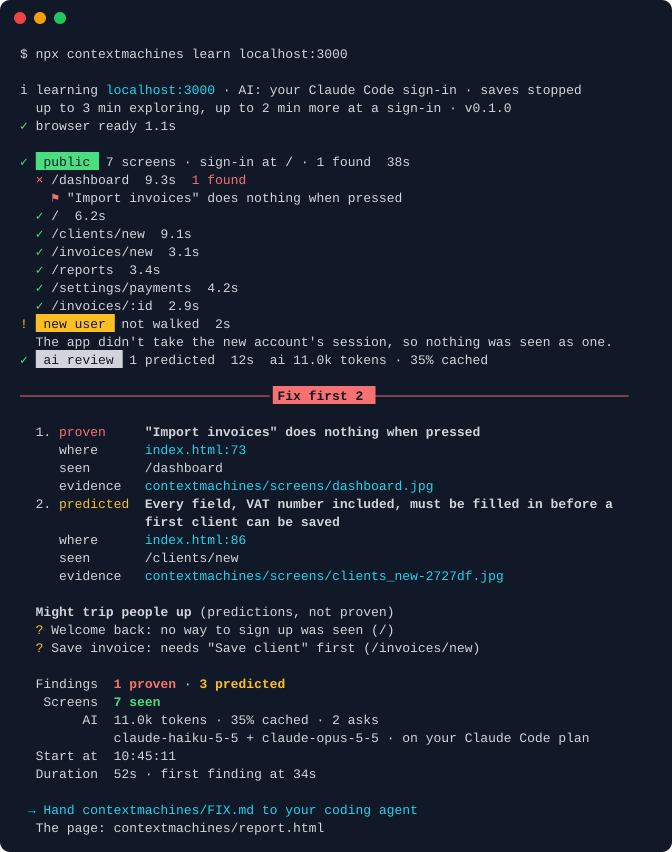

# Context Machines

[](https://www.npmjs.com/package/contextmachines) [](https://github.com/hughhellings/contextmachines/blob/main/LICENSE) [](https://github.com/hughhellings/contextmachines/actions/workflows/ci.yml)

Finds what to fix in your web app. In a few minutes it walks your product the way a new user would, and gives you a short list to hand to your coding agent: problems it proved, and predictions marked as such, each with a file and line where it can find one.

The new-user walk works on your own machine where the browser decides who's signed in: `supabase-js` in a client-rendered app, or a client-rendered app that asks its own `/api`. For anything else, use `--login` with a test account.

```bash
npx contextmachines init     # once: finds your app, which AI reads it, the line for your coding agent
npx contextmachines learn
```

`init` works your project out from the folder: which app, how it starts, where it's running, how people sign in. If it isn't running, it offers to start it, and stops it again afterwards. It lists exactly which files it will change and asks first. On a local app a stand-in user usually gets past the sign-in for you; anywhere else, you sign in once yourself in a browser window with `--login`. [Behind a sign-in](#behind-a-sign-in) says how. To skip it, give the address yourself. The first time, it offers to download its browser (once, about 270 MB); in CI, run `npx playwright@1.61.0 install chromium` first:

```bash
npx contextmachines learn https://yourapp.com
```



> [!NOTE]
> Context Machines is 0.x. What it prints, its options and the shape of `map.json` may still change between minor versions (0.1 to 0.2), never in a patch (0.1.0 to 0.1.1); [CHANGELOG.md](https://github.com/hughhellings/contextmachines/blob/main/CHANGELOG.md) says what changed. The GitHub Action's `@v0.1` tag moves only to 0.1.x patches.

A browser follows links, opens menus and pop-ups, fills in forms with test values and presses their buttons. **Saves are answered in the browser, and anything it can't be sure is only a read is held back** ([what that covers, and what it can't prove](#how-it-stays-read-only)). Then it works out what it saw. On [the example invoicing app](https://github.com/hughhellings/contextmachines/blob/main/examples/invoice):

```
ℹ learning localhost:3000 · AI: your Claude Code sign-in · saves stopped
  up to 3 min exploring, up to 2 min more at a sign-in · v0.1.2
✓ browser ready 1.1s

✓  public  7 screens · sign-in at / · 1 found  38s
  × /dashboard  9.2s  1 found
    ⚑ "Import invoices" does nothing when pressed
  ✓ /  6.1s
  ✓ /clients/new  9.1s
  ✓ /invoices/new  3.2s
  ✓ /reports  3.4s
  ✓ /settings/payments  4.2s
  ✓ /invoices/:id  2.9s
✓  new user  no sign-up seen  2s
✓  ai review  7 reviewed · none predicted  9s  ai 10.0k tokens · 100% cached

──────────────────────────────── Fix first 1 ─────────────────────────────────

  1. proven     "Import invoices" does nothing when pressed
     where      index.html:73
     seen       /dashboard
     evidence   contextmachines/screens/dashboard.jpg

  Findings  1 proven
   Screens  7 seen
        AI  10.0k tokens · 100% cached · 2 asks
            claude-haiku-5-5 + claude-opus-5-5 · on your Claude Code plan
  Start at  18:23:57
  Duration  48s · first finding at 34s

 → Hand contextmachines/FIX.md to your coding agent
  The page: contextmachines/report.html
```

That's the short version: every item's evidence and instruction are in `FIX.md`, and journeys, setup steps, every action and what happened to each save are in what it writes to `./contextmachines`. `--verbose` prints them too.

The last line is a menu, at a terminal only, and it stays until you press Enter (or `q`, Esc), so a stray key never reaches your shell:

| Key | What it does |
| --- | --- |
| `f` | Starts the coding agent the run used (`--ai claude-code` starts `claude`, `--ai codex` starts `codex`) right there, on your repository, with one short ask: fix the problems in `FIX.md`, proven first, checking each one's evidence. The run then ends with the agent's exit code. Not offered with an API key, when that agent isn't on your `PATH`, or when there's no app code in the folder you ran it from |
| `o` | Opens `report.html` in your browser |
| `a` | Lists the rest of the items there, with more than five, numbered as in `FIX.md` (or add `--all`) |
| `c` | Copies `FIX.md`, to paste into any other coding agent (where there's a clipboard tool: `pbcopy`, `clip`, `wl-copy`, `xclip`), its photos named from the folder you ran it in |

When you're done, the menu's place says where the list and the page are. In a pipe, CI, under `--json` or run by a coding agent, there's no menu: the hand-off line, then one plain line naming `report.html`. `NO_COLOR` keeps the menu. In a terminal that opens links (iTerm2, WezTerm, VS Code, Cursor, Ghostty, kitty, Windows Terminal, and Terminal on macOS 15), each item's `where` opens its file (at its line, in VS Code and Cursor's own terminals) and its evidence is its photo's short name (`screens/fix-….jpg`), linked.

Run it from your app's folder: from anywhere else it says there's no app code to point a fix at (on a local app, unless `--no-code`), and it never writes into a `contextmachines/` folder it didn't make (one that holds other files and no `.contextmachines.json`), so give it `--out` there.

Its colours are your terminal's own 16, as a test runner's are, so they follow your theme: each part's badge is black words on one of them (the AI review's is your theme's own text and background swapped), green ticks, running times in bold yellow, and finished times and details dimmed. The AI row says what your AI took, as it said it: the tokens and how many were read from its cache, how many asks, and the models that answered. On a Claude Code or Codex sign-in that's on your plan, and no dollars are shown; with an API key, the cost only where the provider reports one. Each part that asked the AI says what it took at the end of its line, and `map.json` keeps the totals (`learner.ai`).

| File | What's in it |
| --- | --- |
| `FIX.md` | What to fix, proven first: each item with where to change it, its evidence and a suggested change. Hand it to your coding agent |
| `PRODUCT.md` | The product explained, for people and for coding agents: what it's for, the main action, setup steps, journeys, every screen and every action with the request it sends, and the issues it found |
| `report.html` | The page to read, plain like a test runner's report: one line with the site, when, how long, how many problems (proven and predicted, the plain rules' predictions counted as on the terminal), the AI and any big gap (public pages only, a time limit), and links to the files beside it with how many screens and journeys; then the problems in FIX.md's order, filtered by proven, predicted or new, each with where to change it (each place with its own copy button, and the line as it stands), what it was seen on, its evidence and its screenshot (the problem boxed in red where it was measured, opened full size with a click), and "Copy for your coding agent"; then what this run didn't check; then the screens, the journeys grouped by how they came out, issues the list doesn't already say, and what it understood, folded away. Light and dark, readable on a phone and with scripts off, and nothing on it loads from the web |
| `map.json` | The same, as data (`--json` prints it instead) |
| `screens/` | A photo of each screen |

[examples/invoice](https://github.com/hughhellings/contextmachines/blob/main/examples/invoice) has that run's `PRODUCT.md`, `map.json` and photos, and the app itself, to try it on.

## Behind a sign-in

On a local address, nobody has to sign in. As soon as a look through the public pages shows a sign-in in the way, `learn` carries on by itself, while it goes on pressing through the public pages in a browser of their own:

1. **It reads your code**, if you said yes at `init` (or pass `--code`). Your AI lists the screens and actions behind the sign-in. Each claim has to cite a real line of code to be kept.
2. **It walks those screens as a stand-in user with made-up data.** The browser is told it has a user, and every data call is answered in the browser, with rows your AI made up or an empty result.

```text
  ✓ 12 screens and 40 actions read from code, none seen
  Trying a stand-in user with made-up data

      Screens  15 seen · 11 with made-up data · 12 read from code
      Sign-in  not needed for this run: a stand-in user
```

Be clear about what that is:

- **Stand-in screens are your real screens with made-up data.** They show how the product is built, and nothing about any real account. That pass only looks: it presses nothing, and ends once every screen it can reach has been looked at. They're marked wherever they're shown. Numbers, names and rows on them are never judged. Their layout, fixed wording and flow are real, so what's measured there can be on the fix list, marked as seen with a made-up user, and those items are compared by `diff`. Nothing about real accounts is proven.
- **"Read from the code, not seen" is what it says.** A cited line exists, but that doesn't show what's said about it is right. It stays in a section of its own (`fromCode` in `map.json`), and `diff` ignores it.
- **It reaches nothing real.** That browser can't reach anything, your dev server included. Node reads only your dev server's own files and hands them over. No request with that user reaches any server ([how](https://github.com/hughhellings/contextmachines/blob/main/PRIVACY.md#the-stand-in-user)).
- **A run on your machine stays on it, from the first request.** The public pages are walked too, but nothing goes to another host, and an address your project's config hands on to another server (a dev proxy) counts as one: not your real database, not your real sign-in, not fonts or trackers. The result lists the hosts it stayed away from, and a public page that needs one may look different. `--login` and `--create` are the exceptions, as they ask for the real thing.
- **A screen counts only when it really drew.** A sign-in of any kind, a paywall, an error screen, a spinner or a blank page isn't a screen, and it says which it was. Nor is anything drawn at two addresses, or what your app also draws at an address that can't exist: a screen needs made-up data of its own on it, or something no other address draws.
- **It works where the browser decides who's signed in:** `supabase-js` in a client-rendered app, keeping its session in browser storage, or a client-rendered app that asks its own `/api` who's signed in. Where your server decides (server-rendered pages, other sign-in libraries for now) the stand-in says so and stops, the code read still works, and the result names `--login` with a test account as the next step.

3. **It walks your journeys.** Beside all of that, sealed browsers of their own go through what a new account is offered, as far as each journey goes: onboarding past the first step, adding a record, an import, and the rest.

```text
  Finished: "Add an invoice" from /invoices, 4 steps, and what was saved showed afterwards.
  1 stops at a file choice: "First run" on /welcome. A person would choose a real file there, and none was given. Where the walk took one of several choices to get there, it's that choice that ends, not the journey.
  1 stops at an outside account: "Connect a bank" on /payments. It reads like it connects an outside account, so the walk stopped before it.

     Journeys  9 found · 3 finished
```

What the walk says, and what it doesn't:

- **"Finished" means the screens moved on with saves answered in the browser.** It says nothing about your real server. The browser pretends each save worked and keeps it, so a list shows what was added where it can. A save only "showed afterwards" when a fresh load drew it from a read of what was kept, not from the app's own memory. Otherwise it's unknown.
- **An ending it can't follow is the walk's, not your app's.** A pretend answer can make an app stop in a way a real server wouldn't, so it says the walk couldn't follow it, past which step, and no more.
- **What's real is "stopped here".** Payments, emails, invites, outside accounts (banks, OAuth, webhooks), a real file and any other site are never pressed, or the walk ends the moment a press heads for one, by the seal's record of what the page tried, or when a card box shows up or the screen says it's taken money or sent mail. A `DELETE` ends it the same way, whatever the button said. Nothing reaches any of them. Word lists can be wrong, so what it went by is worded "reads like". Where the walk took one of several choices and that led to a stop, it says so, tries the other choices if it has time, and the stop is that choice's, not the journey's.
- **Destructive and sign-out controls are left alone,** and counted. Forms get plainly made-up values, a file chooser is never given a file, and every question a page asks gets a no.
- **It only comes from what was walked.** Every journey this run found is listed with its screen, walked or not, with what couldn't be reached and why and what a time limit left undone. What's found isn't every way through an app. Steps to first value are counted from that walk up to the first save, and it says where the count starts and what's left out.
- **Nothing here is proven.** No check or finding comes from the walk. It can add two predicted items, each resting on a line really drawn: an upgrade asked of a new account on a screen with nothing on it, and a wait for value.
- **The list never waits for it.** It starts as soon as the new account has drawn where it begins, in one browser, takes the new account's other screens as they're drawn, and once that walk is over goes on in up to three browsers side by side (fewer on a small machine), each under a seal of its own. Each journey starts from nothing, whichever browser it's in: what an earlier one saved, its session and what it left in the browser's storage are cleared first. Each journey is listed in the order it began, whichever ended first. It stops when the list is written, at 2m 30s at most, and on a run with nothing else left it's given 30 seconds.

It runs where the stand-in does: `--login`, `--session` and `--create` press nothing and say so, and any other address says why there's no walk. `--no-journeys` leaves it out.

On any other address there's no stand-in user. It says what it can offer instead: run your app locally, `--code`, or `--login` with a test account. `--no-code` and `--no-stand-in` turn each part off.

## Fix first

The result opens with what to fix, at most five in the terminal, and all of it in `FIX.md`. Proven and predicted are never in one list.

**Proven** means the browser saw it or measured it, with no AI: the issues below, and what's measured wrong on a screen (a label cut off, something sitting over a field or button, a plural bug like "1 trades", a page running off sideways at phone width, a control out of reach, a broken image, an error logged as the page loads).

**Predicted** means an AI's reading, and never more. With an AI, it reviews what was drawn on each screen, the rules in your code and what a brand-new account found, and asks one question: where does a person get stuck, wait, pay before they see value, or lose work, and what should change? It sends text, not photos, since only text can be checked. Everything it says is checked by the CLI:

- Each item must quote words really on that screen, or a line really in that file. No evidence, no item.
- Anything built on a made-up number or row is dropped.
- So is taste, and any claim about what real users do. Nobody real was watched.

It would rather miss something than tell you something wrong. `map.json` records how many items were raised and why each was thrown away, under `learner.review`. A rule can add a predicted item with no AI: an empty state a new account met with nothing to do next, or a first-run screen your code names that a new account never reached.

**Where to change it** comes from searching your repository for the drawn words, on your machine, with no AI: a file and line when it's sure, the files to look in when several hold the same words, and nothing when it can't tell. A file your app really runs comes before a mock or a generated copy of it, a label in a shared menu goes to the menu, and an item about something covered names what's on top. It needs to run in your project's git folder. The answer to a same-looking product is kept in `.review.json`, so an unchanged app isn't asked about again.

When it finds nothing it says so, with what it looked at and what it couldn't see. That's never a clean bill of health. Run into the same folder again and `FIX.md` marks what's new since the last run, and lists what the last run had and this one doesn't: gone from the list isn't the same as fixed.

## Issues it can prove

While it explores, it notes what it saw go wrong:

| Kind | What happened |
| --- | --- |
| Does nothing | A button was pressed and nothing happened: no change on the page, no request, no navigation, no dialog |
| Crashes | The page's own script threw an error after a press or a page load |
| Request fails | A request to the site or its API got a 5xx (other than a 503, a busy server's passing state) or no answer at all; a read got a 404 from a framework's error page, or the page then said it failed (a bare 404 is often how an app says "none yet"); or an image of the site's own is on show, broken |
| Broken link | Pressing a link to another page on the same site leads to a 404, 410 or 5xx (other than a 503), or to a page that only says it isn't there. A 404 for an address a router in the browser draws isn't one |

Only what the browser saw happen, each with the screen and the button, link or request involved. Never opinions about design or wording. A false alarm costs more trust than a missed issue, so each kind is tested against traps that look like it but aren't (a button that opens a menu, a request the page expects to 404) and stays quiet on them.

## Might trip people up

After the issues, it lists a few places where a new person is likely to get stuck. These are **predictions, not findings**: nothing was seen to go wrong, and both the terminal and `PRODUCT.md` label them that way. Each comes from a plain rule over what the run mapped, and says what it rests on:

- the first screen asks people to sign in, and no way to sign up was seen anywhere
- an action needs a setup step first, but the journey to it never passes that step
- a button whose words ("Save", "Submit") don't say which of several saves on the screen it is
- something destructive sits beside the main action
- a long journey with no step count

A map too thin to judge gives none. No AI decides these, and no opinions about taste are made. They are in `map.json` under `predictions`, and `diff` lists the ones that are new or gone in a section of their own, never as issues.

## What a change does to the product

Learn before and after a change, and compare:

```bash
npx contextmachines diff before/map.json after/map.json
```

On the example app, before and after a change that renames "Send invoice", adds "Duplicate invoice" and moves "Export CSV" to its own screen (`node examples/invoice/server.mjs --changed`):

```
### What this change does to the product

- ➕ New screen `/settings/exports`
- ➕ New action **Duplicate invoice** (`POST /api/invoices/:id/duplicate`)
- ✏️ **Send invoice** is now **Email invoice** (`POST /api/invoices/:id/send`)
- ↪️ **Export CSV** moved: `/reports` → `/settings/exports`
```

It also says which items on the fix list are fixed and which are new, measured ones on stand-in screens included and marked. Predictions sit apart: one that's gone is "no longer raised", never fixed, and an item on a screen the other run didn't see isn't judged.

It's markdown, ready for a pull request comment (`--json` for builds, `--fail-on-new-issues` to fail one).

## On every pull request

The GitHub Action learns your app before and after the change and keeps one comment on the pull request up to date. Add `.github/workflows/contextmachines.yml`:

```yaml
name: Product diff
on: pull_request
permissions:
  contents: read
  pull-requests: write
jobs:
  contextmachines:
    runs-on: ubuntu-latest
    steps:
      - uses: hughhellings/contextmachines/action@v0.1
        with:
          url: https://pr-${{ github.event.number }}.preview.yourapp.com   # the app after this change
          base-url: https://yourapp.com                                     # the app before it
          anthropic-api-key: ${{ secrets.ANTHROPIC_API_KEY }}               # optional
```

It learns the apps at the addresses you give it; it never builds or runs the pull request's code. The same text goes to the job summary, the screen photos are uploaded as an artifact, and `changed` and `issues` are outputs, for labelling or failing the job (`fail-on-new-issues: true` does that for you). An unchanged product reuses its last AI reading: no cost, same words. On a pull request from a fork the token can't comment, so the result goes to the job summary only. [action/action.yml](https://github.com/hughhellings/contextmachines/blob/main/action/action.yml) lists every input.

For a preview deployed by another workflow, run this after it, with that workflow's preview address as `url`. A user name and password or a bypass token in `url` (`?x-vercel-protection-bypass=…`) is used to get in and left out of the comment and the summary; keep it in a repository secret so GitHub masks it in the log too.

`@v0.1` moves to each 0.1.x patch release and never to 0.2, which may change the comment or the inputs; moving up is your choice. Pin `@v0.1.0` or a commit SHA to never move. [action/README.md](https://github.com/hughhellings/contextmachines/blob/main/action/README.md) has the rest.

## Coding agents

Coding agents read your code, not your product. Add one line to `CLAUDE.md` or `AGENTS.md`:

```
@contextmachines/PRODUCT.md
```

Then "add a filter to the invoices screen" means something: the agent knows which screen, what's on it, and what it saves.

To have the agent run Context Machines itself (learn the app, check a pull request's product diff, find broken buttons), add the skill:

```bash
npx skills add hughhellings/contextmachines
```

It teaches the agent when to use `learn` and `diff`, how to read `PRODUCT.md` and `map.json`, and never to use `--create` on production. It also tells it to fix what `FIX.md` marks as new since the last run first, then run `learn` again to confirm each fix is gone from the list. `--json` prints the result for an agent to read, with progress on stderr.

## Bring your own AI

With an AI, it says what the product is for, names every action and picks the main one. It uses the first one you already have:

| You have | It uses |
| --- | --- |
| `ANTHROPIC_API_KEY` | Anthropic |
| `OPENAI_BASE_URL` | Any OpenAI-compatible server: Ollama, LM Studio, your company's proxy (with `--model`) |
| `OPENAI_API_KEY` | OpenAI |
| `GEMINI_API_KEY` or `GOOGLE_API_KEY` | Google Gemini |
| `AI_GATEWAY_API_KEY` | Vercel AI Gateway (any model it serves) |
| `OPENROUTER_API_KEY` | OpenRouter |
| Claude Code, signed in | Your Claude subscription. No key. (macOS and Linux) |
| Codex, signed in | Your ChatGPT subscription. No key. (macOS and Linux) |

Choose with `--ai` and `--model`; `--ai none` uses none. With a local model (`--ai ollama`), nothing leaves your machine. With a signed-in Claude Code or Codex, only the question is sent: none of your settings, tools, skills or connected servers are loaded.

The AI sees screen titles and headings, button and field labels, and each action's request and field names. For its review it also sees the text drawn on pages reached without a sign-in, on a local app too, with table cells left out, so names and amounts drawn outside a table can go, and so can a name in a button's label, one in a table row included. Never what's in a field, and never the photos. To send none of it, use `--ai none`. [PRIVACY.md](https://github.com/hughhellings/contextmachines/blob/main/PRIVACY.md) has the details.

An unchanged product reuses its last reading, so repeat runs cost nothing. Without an AI you still get every screen, action and issue.

## Options

`npx contextmachines learn --help` and `npx contextmachines diff --help` list them all, with their ranges and defaults.

`npx contextmachines init` sets a folder up, and saves your answers in `contextmachines.config.json`: `{ "url": "http://localhost:3000", "ai": "claude-code", "readCode": true }`. It holds no key or password, so it's safe to commit. `learn` uses it for whatever you don't type: an address or `--ai` on the command line wins. `init --yes --url <address>` takes the defaults without asking, for scripts.

| Option | |
| --- | --- |
| `--out <dir>` | Where to write (default `./contextmachines`) |
| `--minutes <n>` | How long to explore, 1 to 30 (default 3) |
| `--pages <n>` | Most screens to visit, 1 to 500 (default 60) |
| `--login` | Sign in by hand in a browser window first, and it acts as that account. Only the session is saved (in the output folder, readable only by you on macOS and Linux), never a password. Use a test account or staging. |
| `--session <file>` | Reuse a saved sign-in: it acts as that account |
| `--code` | At a sign-in, have your AI read the code for this run. Source files go to the AI you chose, never `.env` files or anything shaped like a secret. `init` saves this as a yes for your local address. |
| `--no-code` | Don't read the code, whatever was saved |
| `--no-stand-in` | Don't use a stand-in user on a local address |
| `--no-journeys` | Don't walk the journeys (onboarding, the main action and the rest) in the sealed browser |
| `--create` | Let its saves really happen, to reach screens that only exist after creating something. **Test accounts only.** Asks first. A write that says it destroys something is stopped; one that doesn't say so goes through. |
| `--yes` | Don't ask before `--create` |
| `--ai <which>` | `anthropic`, `openai`, `google`, `gateway`, `openrouter`, `ollama`, `openai-compatible`, `claude-code`, `codex` or `none` |
| `--model <id>` | The model to ask (each AI has a default) |
| `--reading-cache <file>` | Where the AI reading is kept for reuse (default `<out>/.reading.json`) |
| `--json` | Print the result as JSON; progress goes to stderr |
| `--html` | Does nothing now: `report.html` is always written. Kept so older commands still run |
| `--verbose` | List every screen under its part, and end with the full summary: journeys, setup steps, every action and what happened to the saves |
| `--fail-on-issues` | Exit 1 when it proved something to fix. A prediction never counts |
| `--all` | List every item to fix at the end, not the first five (in a pipe too) |
| `--no-prompt` | No menu at the end. It's only shown at a terminal: never under `--json`, in a pipe, in CI, in the background, or to a coding agent running it. A script run from a terminal waits for a key (up to 10 minutes), so give it this |
| `-v`, `--version` | Print the version |

Exit codes: `0` learned it (with or without issues), `1` something proven to fix with `--fail-on-issues` (or new proven items with `diff --fail-on-new-issues`), `2` something typed wrong, `3` couldn't learn the site (it didn't answer, the browser is missing, or something unexpected), `130` stopped with Ctrl-C. `CONTEXTMACHINES_DEBUG=1` prints the full error when something unexpected stops it; `NO_COLOR=1` turns colour off; `CONTEXTMACHINES_NO_PROMPT=1` does what `--no-prompt` does.

## Requirements

Node 22 or later, and a browser for it to drive: the Chromium of the Playwright version it uses, installed once by `init` or with the command at the top. With the version in it, `npx` fetches that Playwright's browser and not whichever a bare `npx playwright` would. If none is installed, it says so and prints the command.

## How it stays read-only

Everything the browser sends goes through one rule first (`packages/scanner/src/scan.ts`): a request goes out only if it can be shown to be a read, and what can't be shown is held back. Its tests check each line below against a site that records every request it gets. While it explores:

- **Saves are answered in the browser.** That's every request but GET, HEAD, OPTIONS and QUERY, and any GraphQL that isn't a query it can read (a persisted id can't be read, so it counts as a write). The page gets a harmless "OK" of the learner's own and carries on as if it had saved. To another address, a write the page's code sends right after a press is answered the same way and listed as a stopped save with its host; any other is refused. Neither leaves the browser.
- **A request carrying what it typed is a save**, whatever its method or host: a form sent by GET, a mailing list's JSONP. A search box is the exception, since a search is a read.
- **Links and reads that say they act are held back.** An address with a command in it (`/logout`, `/items/4/delete`, `?action=trash`), a link whose words or `data-method` say it acts, or one carrying a CSRF-style token. Signed in, a word that only might be a command is held too. The summary and `map.json` say how many links were held.
- **After a press that says it acts**, everything but a named file is held for five seconds, on any host, sockets included, because the button's request may follow it. Words on the control decide (its text, label, title, icons and the dialog around it), and a confirmation gets a yes only in that window.
- **Every redirect hop** goes through the same rule as the first request. Pop-up windows are refused.
- **Live connections carry only reads.** A WebSocket stays open so pages still draw, and a message reaches the server only if it has the exact shape of a known protocol's upkeep or read. WebSockets inside workers never connect. WebTransport, WebRTC and shared workers are taken away, because nothing can filter them. Service workers are blocked and downloads refused.
- **Risky buttons aren't pressed.** Those that sign out, pay, buy or check out, sign in with another provider (Google, Apple, Microsoft, GitHub), print or close an account.

After a stopped save, the browser's `localStorage`, `sessionStorage` and any cookies scripts can set go back to how they were, so a made-up reply isn't kept. Requests the page sends by itself (trackers and the like) are stopped too, but counted apart and never listed as actions.

### What it can't prove

- **A GET with an innocent name that writes can't be told from a read.** `/api/save-get?name=x` behind a button that says "Refresh stats" reaches the server. From outside it looks like any read; only the server knows. Signed in, that write would land. **So when signed in, use a test account or staging.**
- **Files always load.** An `` the site loads by itself isn't stopped, because scripts, images and fonts are what draw a page. During a hold, only assets with a file name load.
- **Reads to other addresses go out**, unless they carry what it typed or fall inside a hold. The address rule covers the site's own hosts.
- **The word lists are English and a few other languages.** A command in another language behind a plain address isn't recognised.
- **Another site in an iframe** runs in its own process, so its redirect hops aren't paused.

### Signed in

With `--login` or `--session` it acts as that account: everything it reads, it reads as them, and a site may count that (last seen, read receipts, view counts). The rule above is the same, and so are its limits. The browser window you sign in to with `--login` is yours until you press Enter: nothing is stopped there, since you are the one using it.

### With `--create`

Saves go through, so it can reach what only exists after creating something. A write passes only if nothing in its address, its headers or its body says it destroys, and a press on a control that says it destroys, or says nothing at all, isn't made. That's best effort: a destructive write with a neutral name and body goes through, and commands that don't destroy (Publish, Approve, Send) are pressed, and what they send goes through. Writes to other addresses are never sent. Use it on test accounts only.

## Limits

- **Signed-in areas take a local address or `--login`.** On your own machine, a stand-in user gets past a sign-in the browser decides. Elsewhere, or where your server decides, it sees what a signed-out visitor sees unless you use `--login`.
- **A stand-in user sees empty states or made-up rows.** A screen that needs a real record, a paid plan or a staff account stays out of reach, and it says which ones turned it away.
- **A screen needs proof, and some real ones won't have it.** With no rows on screen and only one address, or only empty states, nothing counts: it says nothing was shown rather than guess. Once something is proven, a paywall on one screen is listed as that screen, and two paywalls that each carry a different list could still pass.
- **Sites that turn away automated browsers answer 403.** Its browser is headless and says what it is, which bot protection on many public sites refuses, so it can't learn them. Your own app, its staging and its previews are what it's for.
- **Some screens only exist after creating something** (a record's own page, an editor). `--create` reaches them by letting saves through: use it on test accounts only.
- **Being careful costs some screens.** A link that may act is held back, not followed, and it says how many in the summary and in `map.json`. Apps that send only unreadable GraphQL (persisted queries) draw less, since an operation it can't read counts as a write.
- **Reads aren't all harmless to a site.** See [what it can't prove](#what-it-cant-prove).
- **It's slower on sites with many buttons**, since it presses them to find out what they do. `--minutes` and `--pages` bound the run; the summary says when it stopped at a limit.
- **It explores like one new user.** It finds what's there and what's broken, not how real people use the product: where they hesitate, what they never find. That takes real visits.
- **An issue it didn't see isn't proof there is none.** It reports what it pressed and saw; a button it didn't reach in the time it had isn't checked.
- **A GET that writes under an innocent name can't be seen from outside.** It looks like any read, so it's sent.
- **A redirect to another host is followed on GET.** Reads to other hosts are allowed, and a hop is one.
- **A page whose own address looks like a cart command is treated as one.** `/blog/add-to-cart` is stopped, not read.
- **State kept only in the browser means no main action is named.** With nothing sent to a server, it sees no save to pick from.
- **The default of a few minutes can stop before the whole product is seen.** Raise `--minutes` for a bigger one.
- **How long it takes was measured on one app.** On an app of about 20 screens behind a sign-in, on a laptop, with a signed-in Claude Code: the first proven problem at about 24 seconds, a first run in 3 to 4 minutes, and later runs in about 2½ minutes. A bigger app takes longer: the browser's part follows `--minutes` and `--pages`, and the AI's follows your model and your account's limits. Other AIs weren't timed. Each run's own times are in `map.json`, under `learner.timing`.
- **A first run reads the code it has time for.** The screens get about a minute, a new person's first, staff ones last, and at most 15. What didn't get read is listed, and the next run starts there. A file that changes costs a question about that screen only.
- **A smaller model reads the code where your AI lets it choose.** It's checked the same way as any other, so what it misses is missed, not made up. When the small model's routes can't be tied to the site, it asks once more, then your main model, which adds a minute or two. Why is in `map.json`, under `learner.codeRead.routesAgain`. The review of the screens, where judgement counts, always uses your main model, and so does everything with `--model` or Codex.
- **The journeys' browser asks for less motion** (`prefers-reduced-motion`), as a person may, so an app's animations don't hold up each step. An app that draws different screens for that is walked as it draws them then. Nothing that browser sees is a finding.
- **Journeys walk as a new, empty account.** What needs a record to exist already is listed as out of reach, and a sign-up is shown as stopped at its last press: it's never sent. What's behind it is walked as the made-up account instead, so steps to first value start after it.
- **The journey list changes from run to run,** with what the code read names and what the time limit leaves, so one found this run may be missing the next. The main action can change too, and a predicted item may come and go.
- **A wait for value only shows if the walk gets that far.** Where it needs real data, or a first run the walk can't finish, it's a miss, not a claim.
- **What stops a journey goes by words,** in English first. A payment or email with a plain label, an address outside those words and a screen that doesn't say so can read as finished. Nothing reaches it either way. An `/api/charges` list that only stores rows reads as a payment.
- **Most choices aren't walked.** Of a catalogue, up to three others are tried, the first of each other group and the card that reads least like the one that stopped, time allowing. The line says one of how many it took, and a choice that only moves a screen on, with nothing saved, doesn't count as finished.
- **Screens are looked at once something's saved, 16 at most.** An ask that needs more data than that session holds isn't seen.
- **A save an app makes by replacing rows ends the walk there,** as a `DELETE`. A background call to the app's own `/api` on a press can read as that press saving.
- **The first file named for an item can be another screen's,** when the same words are on both.
- **The stand-in user only knows `supabase-js` and a client app's own `/api`.** Other sign-in libraries stop with a clear message. For an API of its own, the made-up user's shape is a guess, so a screen needing more of it won't draw.
- **It was tested on one real app.** That app used Vite and Supabase. Other frameworks were tried only on hand-written copies of how they behave, and Windows wasn't tried.
- **A local dev server on `https` with its own certificate won't work with the stand-in.** It ends with nothing reached, and nothing leaves.
- **Page addresses are read once, signed out, before the stand-in opens them.** That's how it tells who decides. A read that might act is skipped, and so is anything your dev config says goes to another server. A proxy it can't read from your config would get that one signed-out GET, as it would from any visitor.
- **A file only a dev server knows about can fail to load.** A file in no folder your app's own page loads from isn't believed to be a file. The screen may lose an image, or fail to draw and be reported as not reached.
- **Public pages may differ on a local run.** Fonts, trackers and anything else from another host don't load. A page that needed a script it wasn't given gives no issues on that load, so a real fault there can be missed.
- **Photos carry no made-up mark in the image.** A stand-in photo pasted on its own looks real. The mark is in `PRODUCT.md` and `map.json`.
- **Cookie banners are declined before the photo**, where they offer a way to decline, on a run with no real session. Chat bubbles stay in the photos, and can cover the bottom of a screen.
- **Sample rows have flaws of their own.** A screen may show a blank name or two numbers that disagree. That comes from the made-up rows, not your app.
- **Sign-in is called "not needed for this run" only when rows really drew.** Without an AI to make rows, screens show their empty state, and it says so.
- **A quote check proves a line exists, not that a claim about it is right.** When the same line appears twice, the citation can point at the wrong one.
- **Action names read from code can leak code,** such as `ANALYSIS.save`.
- **The secret filter is best effort.** It knows many shapes, but a plain value under an innocent name still goes to your AI. Keep secrets out of tracked source.

## No telemetry

Context Machines collects nothing about you or your runs, and there is no account. The only connections it makes are:

- **the site you point it at**, through the browser, including whatever that site's pages load themselves (scripts, fonts, images);
- **the AI you choose**, if any: two questions per run, none when the product hasn't changed (with `--ai ollama` it stays on your machine, with `--ai none` there is none). If you said yes to reading your code, some of your source code goes to that AI too, in a handful of questions, and `map.json` lists every file;
- **Playwright's browser download**, once, when you say yes to it in `init` or `learn`, or run `npx playwright@1.61.0 install chromium`.

A signed-in Claude Code or Codex is its own program, with its own settings for what it reports to its maker; Context Machines starts it with only the question.

## Security

What it guarantees, and what it doesn't:

- Saves are answered in the browser unless you pass `--create`, and anything it can't be sure is only a read is held back. A GET that writes behind an innocent name can't be told from a read ([what it can't prove](#what-it-cant-prove)), so use a test account or staging when signed in.
- With `--login` or `--session` it acts as that account.
- Values typed into forms are test values, never yours, and no field's value is sent to the AI.
- Source code goes to your AI only on a yes. `.env` files, paths that name a secret and files holding anything shaped like one stay here. That check goes by shape, so it can't catch everything: a plain-word password in a comment or a key split into parts can still go.
- A stand-in user reaches no server: only your dev server's files leave that browser. That holds for the journeys, the one pass that presses.
- A `PRODUCT.md` you edited is never overwritten: that run's goes in `PRODUCT.new.md` beside it.
- The site's own JavaScript runs in the browser as it would for any visitor, inside the browser's own sandbox. If that sandbox can't start (a container without user namespaces), it warns once and runs without it. Point it at sites you'd visit.
- Secrets in the address you give it (a user name and password, a bypass token) are left out of everything it writes and prints, and out of the Action's comment.
- A saved sign-in (`.session.json`) is a live credential: it is written readable only by you (on Windows, with its folder's permissions) and kept out of git by the output folder's `.gitignore`. Don't share it.

Report a vulnerability privately: [SECURITY.md](https://github.com/hughhellings/contextmachines/blob/main/SECURITY.md).

## See where real users get stuck

This is the outside view: what a new user can see and do. Seeing where real people get stuck takes their visits; a hosted version for that is planned.

## More

[PRIVACY.md](https://github.com/hughhellings/contextmachines/blob/main/PRIVACY.md) · [SECURITY.md](https://github.com/hughhellings/contextmachines/blob/main/SECURITY.md) · [CONTRIBUTING.md](https://github.com/hughhellings/contextmachines/blob/main/CONTRIBUTING.md) · [CHANGELOG.md](https://github.com/hughhellings/contextmachines/blob/main/CHANGELOG.md) · [Code of conduct](https://github.com/hughhellings/contextmachines/blob/main/CODE_OF_CONDUCT.md) · Apache-2.0 [LICENSE](https://github.com/hughhellings/contextmachines/blob/main/LICENSE) and [NOTICE](https://github.com/hughhellings/contextmachines/blob/main/NOTICE)

**Trademark.** The licence covers the code, not the Context Machines name or logo. You may say your work uses or is based on Context Machines, but don't use the name or logo for your own product.
