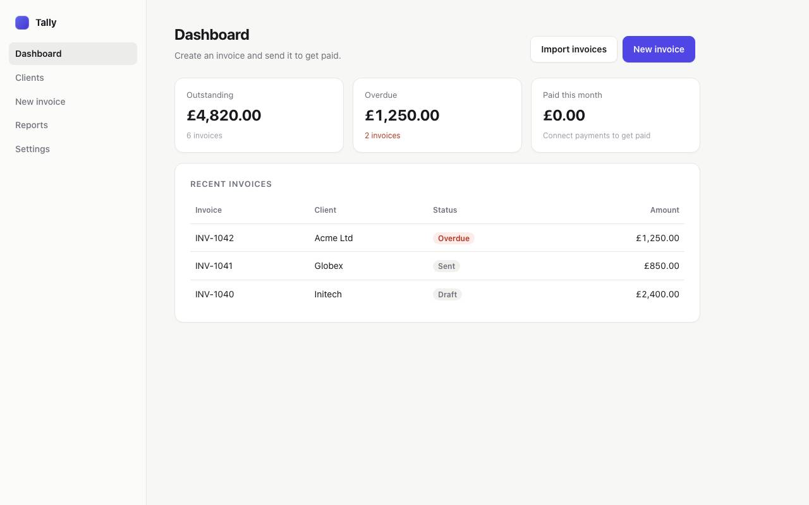

# Tally, an invoicing app to try it on

A small invoicing app to try Context Machines on, and what one run of it wrote. It's a single-page app, the way most products are built, with no dependencies, and it has a problem planted in it: an "Import invoices" button that does nothing.

```bash
node examples/invoice/server.mjs                                  # http://localhost:3000
npx contextmachines learn http://localhost:3000
```

[contextmachines/](contextmachines) is what that run wrote, with a Claude Code sign-in for the AI reading. Yours uses the AI you set with `init` or `--ai`, otherwise the first you have: a Claude Code or Codex sign-in, then an API key; `--ai none` uses none. It wrote:

- [FIX.md](contextmachines/FIX.md): what to fix, with its evidence, where to change it, and what to do
- [PRODUCT.md](contextmachines/PRODUCT.md): what it's for, the main action, setup steps, journeys, every screen and action, and the one issue it could prove ("Import invoices" does nothing when pressed)
- [map.json](contextmachines/map.json): the same, as data
- [screens/](contextmachines/screens): a photo of each screen

It proves the dead button with no AI: pressing it changed nothing and sent nothing. This small app shows the proven path only: anyone can open every screen and there's no sign-up, so there was no sign-in to get past and no new account to walk, and the AI predicted nothing. On an app that has them, predicted items come from the AI's reading and may vary a little from run to run.



## Trying `test`

A goal that passes on this app, from its new-invoice form. "Reg. no." isn't in the goal, so the tester types a plainly made-up value (`TEST-001`) and says so. Whatever it types that isn't in the goal (or a `--var`) is marked "made-up", even a value the AI put into its plan:

```bash
node examples/invoice/server.mjs &
npx contextmachines test "create an invoice for Acme Ltd for 120 and check it opens as a draft" --url localhost:3000/invoices/new
```

The pass is saved in `contextmachines/tests/localhost-3000/`, and the next run replays it with no AI. A goal that checks the new invoice shows the client's name fails, and rightly: the invoice page doesn't show it.

## Trying `diff`

`--changed` serves the same app after a change: "Send invoice" becomes "Email invoice", there's a new "Duplicate invoice" button, and "Export CSV" moves from Reports to its own Exports screen.

```bash
node examples/invoice/server.mjs &
PORT=3001 node examples/invoice/server.mjs --changed &
npx contextmachines learn http://localhost:3000 --out before
npx contextmachines learn http://localhost:3001 --out after
npx contextmachines diff before/map.json after/map.json
```

Last checked with contextmachines 0.2.0 and Node 25.
