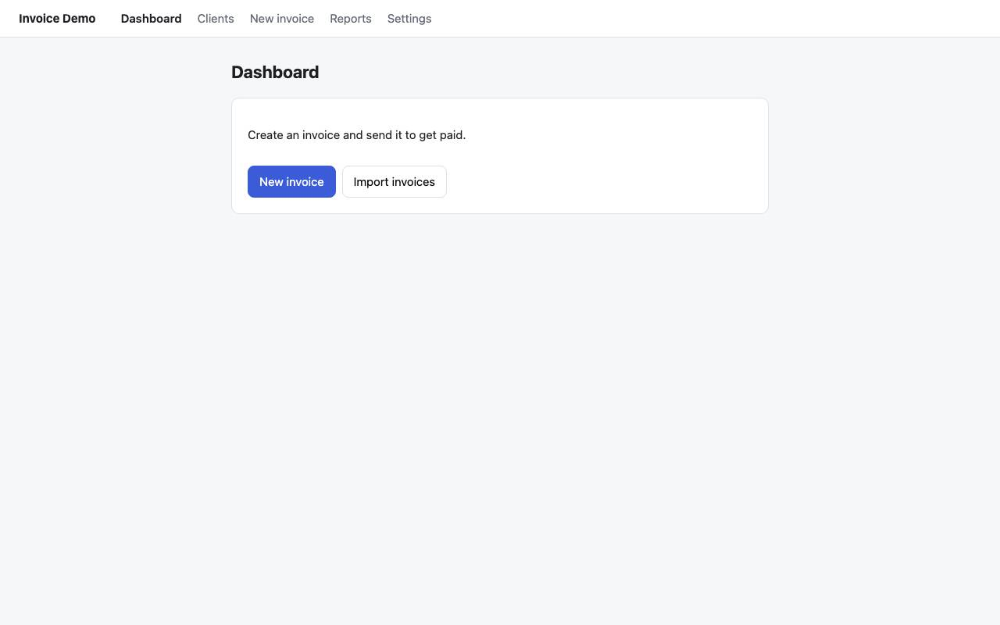

# Invoice Demo

A small invoicing app to try Context Machines on, and what one run of it wrote. It's a single-page app, the way most products are built, with no dependencies, and it has the kinds of problems real products ship with: an "Import invoices" button that does nothing, a required "Reg. no." field nothing explains, and a "Send invoice" that fails until payments are connected.

```bash
node examples/invoice/server.mjs                                  # http://localhost:3000
npx contextmachines learn http://localhost:3000
```

[contextmachines/](contextmachines) is what that run wrote, with an Anthropic API key for the AI reading:

- [FIX.md](contextmachines/FIX.md): what to fix, with its evidence, where to change it, and what to do
- [PRODUCT.md](contextmachines/PRODUCT.md): what it's for, the main action, setup steps, journeys, every screen and action, and the one issue it could prove ("Import invoices" does nothing when pressed)
- [map.json](contextmachines/map.json): the same, as data
- [screens/](contextmachines/screens): a photo of each screen

It found the dead button because pressing it changed nothing and sent nothing. It didn't report the other two, on purpose: a field people don't understand and a setup step they miss show in how real people use the product, not in anything the browser can prove went wrong.



## Trying `diff`

`--changed` serves the same app after a change: "Send invoice" becomes "Email invoice", there's a new "Duplicate invoice" button, and "Export CSV" moves from Reports to its own Exports screen.

```bash
node examples/invoice/server.mjs &
PORT=3001 node examples/invoice/server.mjs --changed &
npx contextmachines learn http://localhost:3000 --out before
npx contextmachines learn http://localhost:3001 --out after
npx contextmachines diff before/map.json after/map.json
```

Last checked with contextmachines 0.1.0 and Node 25.
